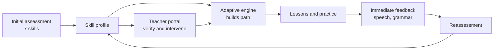
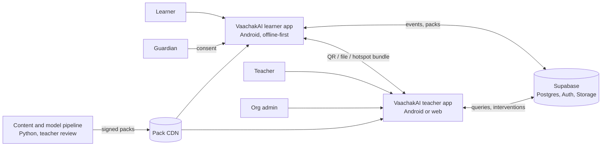
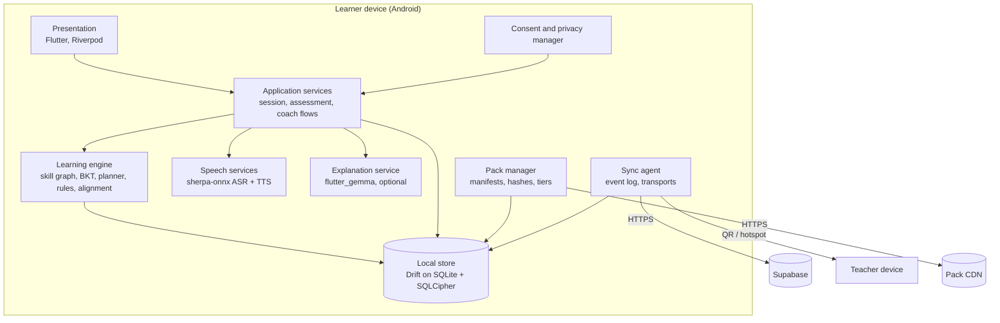
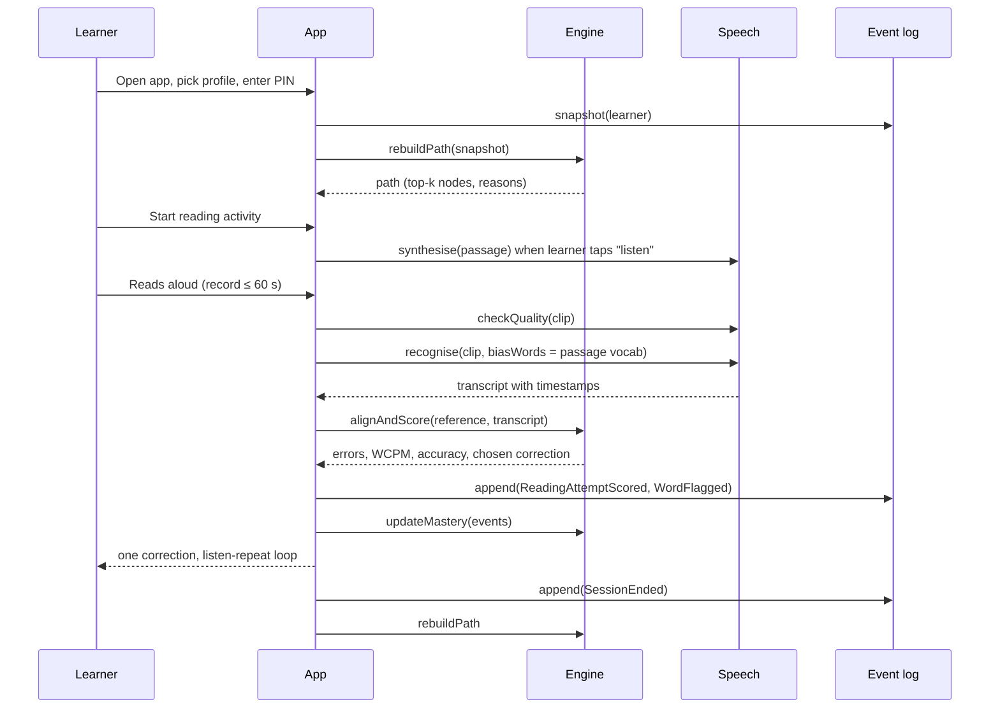
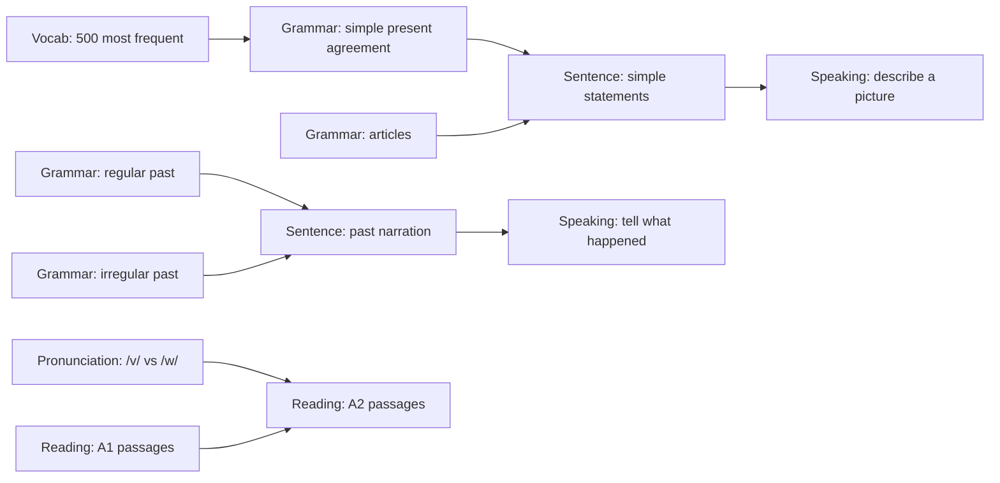
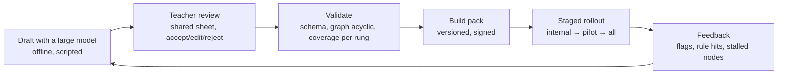

> Historical reference: the web and Android frontends and their build tooling have been removed. See the root README for current setup.

# VaachakAI

**Adaptive, offline-first, on-device English learning with a teacher in the loop**

Version 1.0 · 2026-09-23 · Single source of truth for the project: Part I is the product concept, Part II is the engineering system design.

**Contents**

- [Part I — Project Concept](#part-i--project-concept)
  - Summary · The problem · Existing tools and the gap · Approach · Why it stands out · Learner journey · Teacher portal · How it works · Content strategy · Offline, sync and privacy · Feasibility and build plan · Evaluation · Risks · Concept statement
- [Part II — System Design](#part-ii--system-design)
  - Problem understanding · Requirements · Architecture · Client · Domain model · Algorithms · On-device runtime · Sync · Backend · Security and privacy · Scalability · Reliability · Observability · Content and model lifecycle · Testing · Delivery · Team · Roadmap · Open questions · Appendices

---

# Part I — Project Concept

## Summary

VaachakAI is an offline-first English tutor that diagnoses a learner's specific gaps across seven skills, builds a personalised path, coaches reading and pronunciation one word at a time, and keeps the teacher in the loop, all on an entry-level Android phone with no internet.

*Vaachak* (वाचक) means "reader" or "speaker". The name states the promise: turn every learner into a confident reader and speaker of English, whatever their starting point.

The core idea is simple. Two learners labelled "intermediate" can have opposite problems: one reads well but cannot form sentences, the other speaks freely but mispronounces half the words. Existing apps give both the same course. VaachakAI first measures vocabulary, grammar, sentence formation, reading, pronunciation, listening and speaking separately, then teaches only what each learner actually needs, and re-measures as they improve.

Three choices make the project both distinctive and buildable:

- **Diagnosis before instruction.** A multi-skill profile, not a single level, drives every recommendation.
- **Speech analysis anchored to known text.** Because the system always knows what the learner is supposed to read or repeat, it aligns speech against that reference instead of relying on perfect open-ended speech recognition. This is what makes accurate feedback possible with small on-device models.
- **Teacher in the loop.** The AI proposes, the teacher verifies and intervenes. The adaptive engine is a transparent skill graph, so teachers can see why a recommendation was made.

The platform targets children, school and college students, and adults, with age changing the content and presentation while the learner's measured abilities set the path. It is designed for India's realities: multilingual learners, large classrooms, unreliable connectivity, low-cost phones, and the Digital Personal Data Protection Act's rules on children's data.

## The problem

English learners are sorted into beginner, intermediate and advanced, but learners inside the same band fail for different reasons, and no one has the time to find out which.

**One label hides many gaps.** A class of forty "intermediate" students contains readers who cannot speak, speakers who cannot write a correct past-tense sentence, and confident writers who pronounce *environment* as "en-viro-ment". A fixed course wastes time on what each learner already knows and never reaches what they lack.

**Feedback arrives too late or not at all.** A teacher can listen to perhaps two or three students read aloud in a period. The rest practise mistakes unheard. Written work comes back days later with a red mark but no explanation of why *"She go to school"* is wrong.

**Errors are predictable but untreated.** Speakers of Hindi, Tamil, Bengali and other Indian languages make well-documented English errors: dropped articles, *"doing a mistake"*, *"discuss about"*, present tense for narrating the past, /v/ and /w/ merged in speech. General-purpose apps built for a global audience do not target these patterns.

**Teachers cannot see progress at the skill level.** A term-end score says a student got 58 percent. It does not say that reading fluency rose while sentence formation stayed flat, so interventions are guesses.

**Connectivity and cost rule out cloud tutors.** Many learners share a low-cost phone with intermittent data. Cloud-based speech tools also send children's voice recordings to external servers, which the Digital Personal Data Protection Act, 2023 treats as sensitive and consent-bound.

The gap, therefore, is a tutor that assesses each learner individually across skills, gives immediate and explained feedback on speech and writing, adapts continuously, keeps the teacher informed, and does all of this on the device the learner already owns.

## Existing tools and the gap

No current tool combines skill-level diagnosis, adaptive sequencing, speech coaching, teacher oversight and offline operation. Each covers one or two.

| Tool | Diagnoses per skill | Adapts the path | Reading and pronunciation feedback | Explains grammar errors | Teacher view | Works offline | All age groups |
| --- | --- | --- | --- | --- | --- | --- | --- |
| Duolingo | No, one placement level | Partly, within a fixed tree | Basic speaking checks | No | Limited | No | Mostly adults and teens |
| ELSA Speak | Pronunciation only | Within pronunciation | Yes, strong | No | No | No | Adults |
| Google Read Along | Reading only | No | Yes, word level | No | No | Yes | Children only |
| Grammarly and similar | Writing only | No | No | Partial | No | No | Adults |
| Classroom teaching | Yes, but slowly | Yes, if time allows | Rarely, two or three students a period | Yes | Full | Yes | Yes |
| VaachakAI | Seven skills | Yes, skill graph | Yes, word level, one correction at a time | Yes, with the rule stated | Verify and intervene | Yes, core features | Yes, content by age |

Google Read Along is the closest comparator on offline reading for children and shows the reading coach idea is technically sound on phones. VaachakAI goes beyond it in four ways: multiple skills rather than reading alone, an adaptive path across those skills, grammar explanation, and a teacher portal with verification. Classroom teaching remains the best diagnostic instrument available, which is why VaachakAI is built to extend the teacher's reach rather than replace it.

## The VaachakAI approach

VaachakAI runs one continuous loop for every learner: assess, diagnose, personalise, practise, give feedback, reassess, adapt.



The profile is re-estimated after every activity, not only at formal reassessment, so the path shifts as soon as evidence accumulates. The teacher sees the same profile and can override the engine at any point.

Four principles shape every design decision:

1. **Diagnose before you teach.** No learner enters a lesson sequence until the system has evidence about each skill. Age selects the content style and interface; measured ability selects the path.
2. **One thing at a time.** Feedback names a single, most important error per attempt. A learner who mispronounces three words hears about one, practises it, and then moves on. Over-correction is treated as a bug.
3. **Explain, do not just correct.** Every correction carries the rule behind it in plain language, at the learner's level. The aim is that the error does not recur, not that this sentence gets fixed.
4. **The teacher stays in charge.** AI recommendations are proposals with visible evidence. Teachers approve, modify or replace them, and their decisions feed back into the learner's path.

One hard constraint sits under all four: everything a learner needs in a session must run on a 4 GB RAM Android phone with no network. Any feature that cannot meet this is either redesigned to fit or moved to the optional online layer.

## Why it stands out

The innovation is not "AI for English". It is five specific design choices that together do not exist in any current product.

1. **A skill profile replaces the level.** Seven independently measured skills drive the path. Two learners at the same overall score get different sequences, and the profile is visible to learner and teacher alike.
2. **Reference-anchored speech analysis.** In reading and repeat-after-me tasks the target text is known in advance. The system aligns what was said against what should have been said, which turns a hard open-vocabulary recognition problem into a much easier alignment problem. That is why word-level omission, substitution, repetition and mispronunciation detection can run on a small on-device model with acceptable accuracy for Indian-accented speech.
3. **First-language-aware error diagnosis.** The grammar and pronunciation modules carry a taxonomy of errors typical of Indian-language speakers, so *"I am having two brothers"* is recognised as a stative-verb pattern and explained as one, rather than treated as a random mistake.
4. **An explainable adaptive engine.** Mastery per skill is estimated with transparent, lightweight models such as Bayesian knowledge tracing, not a neural black box. The teacher portal can show "recommended because past-tense accuracy is 41 percent over the last 20 items". This is cheap to run, easy to audit, and something teachers can trust.
5. **Offline, on-device and consent-first by construction.** Speech never has to leave the phone. Sync is optional, minimal and teacher-directed. Children's data handling is designed around the Digital Personal Data Protection Act rather than patched on later.

The short version: **understand the learner first, teach what they actually need, show the teacher why, and do it on a phone with no signal.**

## Learner journey

A learner's first session produces a skill profile in about 20 minutes; every later session starts from that profile and updates it.

**Day one: assessment.** The learner chooses an age band, which sets the look and the content pool. The assessment then samples each skill with adaptive item selection, so a strong reader is not made to read "This is a dog" for five minutes.

| Skill | How it is measured | Signal captured |
| --- | --- | --- |
| Vocabulary | Picture-word match, word-in-context, odd-one-out | Known-word estimate by frequency band |
| Grammar | Fill-the-gap, error spotting, choose the form | Accuracy per grammar point |
| Sentence formation | Reorder words, complete a sentence, describe a picture in text or speech | Structure, agreement, word order |
| Reading | Read words, then sentences, then a short passage aloud | Words correct per minute, error types |
| Pronunciation | Repeat target words and phrases | Word- and later phoneme-level confidence |
| Listening | Hear a clip, answer two or three questions | Comprehension accuracy |
| Speaking | Answer a prompt or describe a picture aloud | Fluency, length, structure, error patterns |

**The skill profile.** The result is a profile, not a score. For a sample school student:

| Skill | Mastery | Band |
| --- | --- | --- |
| Vocabulary | 78% | Strong |
| Grammar | 55% | Moderate |
| Sentence formation | 38% | Weak |
| Reading | 80% | Strong |
| Pronunciation | 60% | Moderate |
| Listening | 70% | Moderate |
| Speaking | 42% | Weak |

**The personalised path.** The engine orders work by weakest skill first, subject to prerequisites. Sentence formation depends on grammar points such as subject-verb agreement, so the path becomes: subject-verb agreement, then simple sentence building, then speaking practice using those sentences, then reading passages that reuse the same structures. Another learner with weak pronunciation and strong grammar gets a path that starts with sounds and words.

**A reading session.** The learner reads a passage at their level aloud. The coach flags one word, say *environment*, plays it, asks for a repeat, scores the attempt, and moves on. Fluency and accuracy are logged. Nothing else in that passage is corrected today unless the learner asks.

**A grammar session.** The learner types or says *"She go to school every day."* The coach shows the corrected sentence and states the rule: *she* is third-person singular, so *go* becomes *goes* in the simple present. It then offers three similar sentences to practise, and the mastery estimate for that grammar point updates with each answer.

**Reassessment.** Every two to three weeks, or when the engine sees enough evidence of change, a short targeted reassessment re-measures the skills that were being worked on. The profile updates, the path is rebuilt, and the learner sees a before-and-after view.

The learner dashboard answers four questions at a glance: Where am I? What am I weak at? What should I do next? Am I improving?

## Teacher portal

The teacher portal turns one teacher's attention into forty individual diagnoses, and keeps the final decision human.

**Class overview.** For each class the teacher sees active learners, average mastery per skill, the distribution of weakest skills, and a list of learners the engine flags as stalled or regressing. The most useful single view is "what is this class struggling with most", which directly informs the next lesson.

**Individual profile.** Opening a student shows the current skill profile, the history of assessments, recent activity, and the specific evidence behind each estimate: the last reading passages with flagged words, the grammar points with the lowest accuracy, and sample sentences the student produced.

**AI insight with evidence.** The engine surfaces findings as claims with supporting data, for example: *"Aarav is struggling with past-tense sentence construction: 9 of the last 14 past-tense items were wrong, mostly irregular verbs."* The teacher can open the 14 items.

**Verification and intervention.** For each insight the teacher can approve the recommended path as is, assign extra practice on a chosen skill, replace the recommendation with their own activity, mark the insight as wrong (which lowers that rule's weight for this learner), or add a note that the learner sees in their next session. Every teacher action is logged against the learner's profile, so a later view can show whether an intervention was followed by improvement.

**Progress over time.** Assessment history is shown per skill, so a teacher can see that reading fluency went from 48 percent at the first assessment to 74 percent at the third while speaking stayed flat, and act on the flat line.

**Working offline.** The teacher app holds its own copy of assigned learners' summaries. Learner devices push compact progress bundles to the teacher device by QR code, file share or, later, a classroom hotspot, or through a server when one is reachable. Teachers never need raw audio; they receive scores, flagged words and sample transcripts.

## How it works

The product rests on four engineering ideas; each is specified in full in Part II.

- **A three-tier intelligence strategy.** Deterministic code first (scoring, the adaptive engine, alignment, grammar rules, templates), small on-device models second (speech recognition, text-to-speech, pronunciation scoring, an optional 1 to 2 billion parameter explanation model), and an optional online tier third that is never required for a session. See Part II §3 and §7.
- **A transparent adaptive engine.** A skill graph of roughly 60 to 80 nodes with prerequisites; Bayesian knowledge tracing per node; a path planner that ranks nodes by expected gain and states its reason in one sentence; a difficulty ladder inside each node. See Part II §6.1–6.2.
- **A reading and pronunciation coach anchored to known text.** On-device recognition biased toward the passage vocabulary, alignment of the transcript against the reference, classification of omissions, substitutions, repetitions and hesitations, words-correct-per-minute, and a single chosen correction per attempt. Phoneme-level scoring and an Indian-language sound-contrast taxonomy arrive in phase 2. See Part II §6.3–6.4.
- **A grammar coach that is rules first, model second.** A table of around 40 high-frequency error patterns typical of Indian-language speakers, each with a detection rule, the corrected form and a levelled explanation; an optional on-device instruction model paraphrases explanations and generates practice sentences, with strict validation and a template fallback so the feature never breaks. See Part II §6.5.

| Learner produces | Standard form | Underlying pattern | Explanation given |
| --- | --- | --- | --- |
| She go to school every day. | She goes to school every day. | Third-person singular agreement | *She* is one person, so the verb takes *-s* in the simple present. |
| I am doing a mistake. | I am making a mistake. | Collocation transfer from *karna* | In English we *make* a mistake; *do* is used for tasks and work. |
| I am having two brothers. | I have two brothers. | Progressive with stative verb | *Have* for possession is not used in the *-ing* form. |
| We discussed about the plan. | We discussed the plan. | Redundant preposition | *Discuss* takes its object directly, with no *about*. |
| He is going to market. | He is going to the market. | Article omission, no articles in the first language | English needs *the* before a specific, known place. |
| Yesterday I go to Delhi. | Yesterday I went to Delhi. | Past narrated in present | *Yesterday* signals the past, so the verb changes to *went*. |
| My cousin brother is here. | My cousin is here. | Indian-English compound | *Cousin* already covers brothers and sisters of that kind. |

## Content strategy

Lesson content is built once, reviewed by teachers, and shipped with the app; the only text generated at runtime is explanations and practice sentences, and those have a template fallback.

**Why not generate lessons on the fly.** Runtime generation on a small model is slow, uneven in quality, and impossible to review before a child sees it. A pre-built bank is fast, offline, reviewable and consistent. A large model is used offline, at build time, to draft items and passages in volume; English teachers review and tag them before they enter the bank.

**Bank structure.** Every item carries a skill-graph node, a difficulty, a CEFR level and an age band. The initial bank targets roughly 1,500 assessment and practice items, 300 reading passages, 2,000 vocabulary entries with pictures and audio, and 150 listening clips. Listening and model-pronunciation audio is generated at build time with a neural voice and spot-checked by a teacher.

**Level ladder.** Levels follow the Common European Framework of Reference so that progress is meaningful outside the app.

| Level | Reading example | Typical learner |
| --- | --- | --- |
| Pre-A1 | This is a dog. The dog is running. | Young children, first exposure |
| A1 | Riya goes to school every morning. She likes reading with her friends. | Primary students, adult beginners |
| A2 | Short paragraphs on daily life with past and future tenses | Middle school, working adults |
| B1 | Longer passages, news-style pieces, simple workplace email | High school and college |
| B2 | Articles, stories, reports with complex sentences | Advanced college and professionals |

**Age band changes the context, not the level.** The same A2 grammar node is taught with a story about a school trip for a child, an exam-style paragraph for a student, and a bank-visit dialogue for an adult. Older learners get the adult content with larger text, slower pacing and fewer items per session.

**Teacher contributions.** Teachers can add passages and items from the portal for their own class immediately, and submit them to the shared bank for review.

**Updates.** New content ships as versioned packs that a device fetches when online or receives from a teacher device, so a school can refresh its content once and distribute it without internet.

## Offline, sync and privacy

A learner can install the app once, complete every session without a network, and share progress with a teacher over a QR code or a classroom hotspot; nothing sensitive ever has to leave the phone.

- **Local-first storage.** Profiles, mastery estimates, activity logs and the content bank live in an encrypted database on the device. Models ship as packs: a mandatory core pack and optional packs for phoneme-level pronunciation and the explanation model, downloadable on Wi-Fi, copyable from a teacher's device, or side-loadable from a memory card.
- **Sync as a small, append-only bundle.** A learner device exports a few kilobytes: mastery per node, assessment history, flagged errors, short sample transcripts, and acknowledgements of teacher notes. Bundles are append-only event logs, so merging never conflicts. Teacher actions travel back the same way.
- **Privacy by design, aligned with the Digital Personal Data Protection Act, 2023.** Voice is processed in memory and discarded by default; learners under 18 require verifiable guardian consent per feature; data is limited to what the learning loop needs, with no advertising or tracking kits; teachers see only assigned learners and never raw audio unless a clip was explicitly shared; deleting a learner wipes the device record and propagates to any synced copy.
- **Authentication.** Learners sign in with a local PIN that works offline. Teachers set up classes with class codes that learners enter once, so no central account is needed for a classroom to start.

## Feasibility and build plan

A working prototype with assessment, adaptive paths, a reading coach and a teacher dashboard is achievable in eight weeks by a five-person team using open models that already run on Android.

**Target device.** Android 8.0 or later (Android 10 for the explainer pack), 64-bit ARM, 4 GB RAM, 2 GB free storage. This covers most phones sold in India in the last four years, including entry-level devices around the 8,000 to 12,000 rupee mark. The teacher app runs on the same class of phone or as a web dashboard on a laptop.

**Technology stack.** One Flutter codebase for every screen, two Flutter packages for all on-device AI, and a managed backend, so the team writes learning logic instead of native plumbing and servers.

| Layer | Choice | Why it is faster to build |
| --- | --- | --- |
| Learner app, teacher app, teacher web dashboard | Flutter with Riverpod for state | One Dart codebase builds Android, web and desktop; the teacher dashboard is the same app compiled to web |
| Speech recognition and text-to-speech | sherpa-onnx Flutter package | One plugin runs offline Whisper or Zipformer recognition with word timestamps and Piper-style voices; no native build steps |
| Adaptive engine, alignment, grammar rules | Plain Dart | Deterministic, unit-testable code; nothing to integrate in phase 1 |
| Correction beyond rules and explanations | flutter_gemma (Google AI Edge) running a Gemma-class 1 to 2 billion parameter model | Optional pack, a few lines to prompt, and it replaces a separate grammar model |
| Phoneme scoring, phase 2 | onnxruntime Flutter package | Loads a quantised phoneme model without native code |
| Local database | Drift on SQLite with SQLCipher | Typed queries, reactive UI updates and encryption from one dependency |
| Backend, auth and sync | Supabase through supabase_flutter | No server to write; "teachers see only assigned learners" is a row-level security policy; free tier for pilots; self-hostable later |
| Content pipeline | Python scripts and a shared spreadsheet for teacher review, exported to JSON bundled in the app | No custom review tool |
| Charts | fl_chart | Skill profiles and progress lines in-app |

This drops four things from a typical build: hand-written whisper.cpp and llama.cpp bindings, a separate grammar model in phase 1, a custom server, and a second web codebase for the dashboard. Firebase is a fine substitute for Supabase if the team already knows it.

**Footprint budget.** Sizes are approximate and will be confirmed by benchmarking on three reference phones.

| Component | Candidate | Approximate size | Pack |
| --- | --- | --- | --- |
| App, rules, content bank | Flutter app, Drift on SQLite | 150 MB | Core |
| Speech recognition | sherpa-onnx with Whisper tiny or base English, 8-bit, or a Zipformer English model | 40 to 150 MB | Core |
| Text-to-speech voice | sherpa-onnx with a Piper-style voice | 60 MB | Core |
| Phoneme scoring model | wav2vec2-class phoneme recogniser through onnxruntime, quantised | 100 to 300 MB | Pronunciation |
| Explanation and correction model | Gemma-class 1 to 2 billion parameter model, 4-bit, through flutter_gemma | 0.7 to 1.5 GB | Explainer |

The core pack is 250 to 350 MB. With every optional pack installed the total stays near 2 GB.

**Latency targets on the target device.**

| Operation | Target |
| --- | --- |
| Recognise a 15-second reading clip | Under 4 seconds |
| Align transcript and classify errors | Under 100 milliseconds |
| Rule-based grammar check | Under 50 milliseconds |
| Model-based grammar correction | Under 3 seconds on the instruction model |
| Explanation from on-device model | Under 6 seconds, template shown instantly |
| Model pronunciation of one word | Under 300 milliseconds |

**Phased roadmap.**

| Phase | Weeks | Delivers | Demonstrable outcome |
| --- | --- | --- | --- |
| 1. Prototype | 1 to 8 | Assessment for vocabulary, grammar, sentence formation, reading and listening; skill profile; knowledge-tracing engine; A1 to B1 content bank; rule-based grammar coach with templates; reading coach with word-level flags and words-correct-per-minute via sherpa-onnx; learner dashboard; teacher dashboard as the same Flutter app on web, with QR bundle import and Supabase sync when online | A learner is assessed, gets a path, reads aloud and is corrected, and the teacher sees it, all offline |
| 2. Depth | 9 to 16 | Phoneme-level pronunciation pack; speaking prompts; on-device instruction model pack for correction and explanations; expanded first-language error taxonomy; hotspot sync between devices; consent flows; Hindi interface | Full seven-skill loop with explained feedback |
| 3. Pilot | 17 to 24 | Two to three classroom pilots; teacher content authoring; item calibration from response data; adult and older-learner content; accessibility review | Measured learning gains and teacher feedback |

**Team.** Two Flutter developers, one engineer who owns the model packs and the sherpa-onnx and flutter_gemma integration, one developer who sets up Supabase, the content pipeline and the web build, one English educator as content and pedagogy lead, and one designer shared across learner and teacher experiences. With no custom server or native build, the backend role is part-time and can be absorbed by a Flutter developer on a four-person team.

**Deliberately out of scope for now.** Free-form conversation with an AI tutor, automated essay scoring, and interface languages beyond English and Hindi. Each needs a larger model or more content than the offline budget allows and can be revisited once the core loop is proven.

## Evaluation and success metrics

The project is judged on whether learners improve faster than on a fixed course and whether teachers trust and act on its diagnoses, with system quality measured on the target phone.

| Area | Metric | Target |
| --- | --- | --- |
| Learning | Per-skill mastery gain, initial versus 6-week reassessment, against a control group on a fixed course | Larger gain on each learner's two weakest skills |
| Learning | Words correct per minute on level-matched passages | Measurable rise for learners starting below level |
| Learning | Recurrence rate of a targeted grammar pattern after explanation and practice | Falls session over session |
| System | Speech recognition word error rate on Indian-accented read speech, reference-biased | At most 15 percent for adults, 25 percent for children |
| System | Precision of flagged reading errors against teacher judgement | At least 80 percent |
| System | Precision of rule-based grammar corrections on the taxonomy set | At least 95 percent |
| System | Latency targets met on three reference phones; crash-free sessions | All targets; at least 99 percent |
| Teacher | Time to identify the three learners most in need, before and after | Shorter |
| Teacher | Share of AI insights approved, modified or rejected; interventions followed by improvement within two weeks | Tracked as trust and accuracy signals |
| Engagement | Sessions per learner per week, completion rate, retention at four weeks | Tracked |

**Pilot design.** Two to three classrooms, around 100 learners, six to eight weeks, with guardian consent. Half the classes use VaachakAI paths and half a fixed sequence from the same content bank, so the comparison isolates the adaptive loop. Teachers rate diagnostic accuracy weekly, and consented response data calibrates item difficulty for later releases.

## Risks and mitigations

| Risk | Impact | Mitigation |
| --- | --- | --- |
| Speech recognition is unreliable for children and regional accents | Wrong corrections erode trust | Reference-biased decoding against known text; Indian-English acoustic model; confirm-before-correct prompts; confidence thresholds tuned on consented pilot data |
| Low-end phones lack storage or memory for models | Learners cannot install | Tiered model packs; core pack works without the explanation model; benchmarking on three reference phones from week 2 |
| Generated content is wrong or inappropriate for children | Harm and loss of credibility | No runtime lesson generation; build-time generation with teacher review; templated explanations for known errors; validated model output; in-app flagging by teachers |
| Scope grows beyond what a small team can build | Nothing ships | Phase 1 fixed at five skills plus the reading coach; each later feature has a named phase and an out-of-scope list |
| Learners are discouraged by too many corrections | Drop-off | One correction per attempt as a hard rule; positive framing; teacher-adjustable sensitivity |
| Consent and children's data obligations are missed | Legal and ethical exposure | Guardian consent before processing; in-memory audio by default; local encryption; erasure propagated through sync |
| Adaptive engine gives poor recommendations early, with little data | Weak first impression | Adaptive initial assessment; age-band priors; teacher override from day one; item calibration as data accumulates |
| Teachers do not adopt the portal | The human loop breaks | Evidence-backed insights; setup through class codes; QR and hotspot sync with no server; a class view that directly informs the next lesson |
| Model licences restrict use | Rework late in the project | Prefer permissively licensed models such as Whisper, sherpa-onnx and Piper voices; check the licence of any instruction model before it enters a pack |

## Concept statement

VaachakAI is an offline-first, on-device English tutor that adapts to each learner instead of asking every learner to adapt to one course. It measures vocabulary, grammar, sentence formation, reading, pronunciation, listening and speaking separately, builds a personalised path from that profile, and updates the path as the learner practises. Reading and pronunciation are coached one word at a time by aligning speech against known text, so accurate feedback runs on a low-cost phone with no network. Grammar errors are corrected with the rule stated, using an error taxonomy built for speakers of Indian languages. A teacher portal shows every learner's profile with the evidence behind each insight, and keeps teachers in charge of what happens next. Built on open, on-device models, a transparent adaptive engine and consent-first data handling, VaachakAI makes individual English tuition available to children, students and adults wherever they are, with or without a signal.

---

# Part II — System Design

**Status:** Draft v1.0 · **Date:** 2026-09-23 · **Owner:** Director of Engineering · **Audience:** engineering, product, pedagogy, security, pilot partners

This is the engineering blueprint for VaachakAI. It states what we are building, every situation the system must survive, the architecture decisions and why we made them, and the concrete contracts a team can build against. Part I explains the product; Part II explains how it works and how it scales.

---

## 1. Problem understanding

### 1.1 What the product must do

VaachakAI replaces the "one course for everyone" model with a loop: **assess → diagnose → personalise → practise → feedback → reassess → adapt**. It must:

1. Measure seven skills independently: vocabulary, grammar, sentence formation, reading, pronunciation, listening, speaking.
2. Produce a skill profile, not a single level, and rebuild a personalised path from it after every session.
3. Coach reading and pronunciation one correction at a time from speech captured on the phone.
4. Correct grammar and state the rule behind each correction, with an error taxonomy tuned to speakers of Indian languages.
5. Give teachers a class view, individual profiles, evidence-backed AI insights, and the power to approve, modify or override.
6. Run every learner-facing feature with no network on a low-cost Android phone.
7. Keep learner speech and records private by default and comply with India's Digital Personal Data Protection Act, 2023 (DPDP), including verifiable guardian consent for learners under 18.

### 1.2 What makes this hard

| Difficulty | Why it matters | Design response |
| --- | --- | --- |
| Speech recognition on small models for children and Indian accents is unreliable | Wrong corrections destroy trust faster than no corrections | Never do open-ended recognition when the text is known; align speech against the reference (§6.3) and confirm before correcting |
| Seven skills × ages × levels is a large content and logic surface | A small team can drown | Deterministic engine in plain code, pre-built content bank, models only where nothing else works (§4.3) |
| "Offline" is not one condition | Some devices are never online, some are online once a month, some always | Event-sourced client with opportunistic sync over three transports (§8) |
| Devices are shared, lost, replaced, low on storage | Data must survive, and must not leak | Multi-profile device model, encrypted store, server restore when consented, tiered model packs (§7, §9) |
| Children's data has legal weight | DPDP obligations apply to us as the data fiduciary | Consent as a first-class entity, in-memory audio, erasure propagation (§10) |
| Teachers have no time | A dashboard nobody opens is a failure | Insights carry evidence and one-tap actions; setup with a class code; no server needed for a class (§5.4) |
| Scale from one pilot classroom to a state programme | The architecture must not need a rewrite at 100k learners | Inference at the edge; the server only ingests small event batches and serves aggregates (§11) |

### 1.3 Personas and situations the system must handle

**Learners**

| Persona | Situation | Implication |
| --- | --- | --- |
| Child, 7–12, in a school class | Shares a family phone or a school tablet; guardian consent required; teacher-linked | Multi-profile device, PIN switch, consent gate before microphone, simplified UI |
| School or college student | Own phone, intermittent data, exam goals; teacher-linked, possibly also enrolled at a coaching centre | Learner can belong to several classes; opportunistic sync; academic content |
| Adult, self-directed | No teacher, no class, wants workplace English; may never sync | Full loop must work with zero teacher involvement and zero server contact |
| Older learner | Returning to study, needs larger text, slower pace, patience | Accessibility settings, fewer items per session, no time pressure by default |

**Teachers and institutions**

| Persona | Situation | Implication |
| --- | --- | --- |
| Teacher with 40 students and a phone | No school server, hotspot at best | Teacher app is the same Flutter app; sync via QR bundle or hotspot; dashboards computed locally |
| Teacher with a laptop and internet | Wants a bigger screen | Same codebase built for web/desktop; Supabase-backed |
| Co-teachers, teacher change mid-year | Two people need the same class; a new teacher inherits history | Class has many teacher assignments with start/end dates; access is by assignment, not ownership |
| School or district administrator | Needs aggregate views, data residency, procurement assurances | Org tenancy, self-hostable backend in India, audit logs |

**Environment and device situations**

| Situation | Required behaviour |
| --- | --- |
| Never online | App and model packs side-loaded from a teacher device or memory card; progress exported by QR or file |
| Online once a month | Queue events locally without limit for at least 90 days; sync in the background when connectivity appears |
| Online always | Background sync every few minutes; teacher dashboard live |
| 2–3 GB RAM phone | Core pack only; smallest recogniser; no LLM |
| 4 GB RAM phone | Core plus pronunciation pack |
| 6 GB and above | All packs |
| Low storage | Pack manager refuses installs that would leave under 500 MB free; app keeps working with what is installed |
| Phone lost or replaced | Data at rest encrypted; learner restores from server if consented and synced, otherwise from a backup file |
| Microphone permission denied | Every speech activity has a text alternative; profile still updates from text evidence |
| Noisy classroom | Noise gate and signal-quality check before scoring; "try again in a quieter spot" rather than a wrong score |
| Wrong device clock | Ordering by device sequence and hybrid logical clocks, never by wall time alone |
| App updated mid-life | Versioned schema migrations; old events remain readable; packs declare compatible app ranges |
| Guardian withdraws consent | Processing stops immediately; local data purged; erasure event propagates to every synced copy |

---

## 2. Requirements

### 2.1 Functional requirements (summary)

| ID | Requirement |
| --- | --- |
| F1 | Adaptive initial assessment across seven skills, resumable, under 20 minutes |
| F2 | Skill profile with per-node mastery estimates and confidence, updated after every attempt |
| F3 | Personalised path rebuilt after every session, explainable in one sentence per recommendation |
| F4 | Reading coach: word-level omission, substitution, repetition, hesitation; words correct per minute; one correction per attempt |
| F5 | Pronunciation coach: word-level (phase 1) and phoneme-level (phase 2) scoring; listen–repeat–rescore loop |
| F6 | Grammar coach: rule-based correction and explanation; model-based fallback; practice loop |
| F7 | Content bank tagged by skill node, difficulty, CEFR level and age band; versioned packs |
| F8 | Learner dashboard: level, weaknesses, next steps, progress over time |
| F9 | Teacher portal: class overview, individual profiles, insights with evidence, approve/modify/override, notes |
| F10 | Multi-profile devices, class codes, teacher assignments with dates, learners in many classes |
| F11 | Sync over Supabase, QR/file bundle, and LAN hotspot (phase 2), all optional |
| F12 | Consent management, data export, erasure |

### 2.2 Non-functional requirements

| Category | Requirement |
| --- | --- |
| Offline | 100% of learner session features available with no network after install |
| Latency (4 GB reference phone) | Recognise 15 s clip ≤ 4 s; align ≤ 100 ms; rule grammar check ≤ 50 ms; LLM explanation ≤ 6 s with template shown instantly; TTS word ≤ 300 ms; cold start ≤ 3 s |
| Footprint | Core pack ≤ 350 MB; all packs ≤ 2 GB; app RAM ≤ 600 MB in core mode, ≤ 1.8 GB with LLM loaded |
| Battery | A 20-minute session ≤ 5% battery on the reference phone |
| Reliability | Crash-free sessions ≥ 99.5%; no data loss on crash (write-ahead, transactional) |
| Sync | Events delivered within 24 h of connectivity ≥ 99%; exactly-once effect (idempotent) |
| Scale | 1M learners, 10M sessions/month, without architectural change; single pilot on the free tier |
| Security | Encrypted at rest and in transit; least privilege by row-level security; signed model and content packs |
| Privacy | No raw audio persisted by default; no third-party tracking or ad SDKs; DPDP-compliant consent and erasure |
| Accessibility | Font scaling to 200%, high contrast, TTS of instructions, touch targets ≥ 48 dp |
| Localisation | UI in English and Hindi at launch; content in English; framework ready for more |
| Compatibility | Android 8.0+ for core (64-bit), Android 10+ for the explainer pack; teacher web on evergreen browsers |

### 2.3 Constraints and assumptions

- Target hardware is an Android phone in the ₹8,000–12,000 class; iOS is out of scope for v1.
- The team is five to six people; the stack must minimise native code and servers.
- Content is authored offline and reviewed by teachers; runtime generation is limited to explanations and practice sentences with template fallback.
- The backend is Supabase (managed at first, self-hosted in India for institutional deployments).
- The organisation deploying VaachakAI is the data fiduciary under DPDP; schools act as data processors or joint fiduciaries depending on the contract. Legal review is a launch gate.

---

## 3. Architecture overview

### 3.1 Guiding decisions (ADR summary)

| # | Decision | Rationale | Consequence |
| --- | --- | --- | --- |
| ADR-1 | **All inference runs on the device.** The server never sees audio and never runs models for learners. | Offline requirement, privacy, and cost; server load per learner becomes tiny | Model packs, device tiers and degradation ladders are core concerns |
| ADR-2 | **The client is event-sourced.** Every learner action is an immutable event; mastery, paths and dashboards are derived by folding events. | Sync becomes append-only and conflict-free; state is reproducible; bugs in the engine can be fixed by re-folding | Need compaction and snapshotting for long histories |
| ADR-3 | **Deterministic adaptive engine (Bayesian knowledge tracing) in plain Dart.** | Explainable to teachers, unit-testable, milliseconds to run, no model to ship | Item difficulty calibration comes later from data |
| ADR-4 | **Reference-anchored speech analysis.** | Turns open recognition into alignment; feasible on small models | Free speaking tasks get lighter-weight scoring than reading tasks |
| ADR-5 | **One Flutter codebase** for learner, teacher and web. | Team size; one UI system; teacher dashboard for free | Web build cannot run on-device models; teacher web is dashboard-only |
| ADR-6 | **Supabase as backend**, self-hostable. | No server code for auth, storage, Postgres, row-level security; data residency by self-hosting | Design tables and policies carefully; plan the migration path past a single Postgres |
| ADR-7 | **Signed, tiered model and content packs.** | Devices differ; packs must be trustworthy when side-loaded | Pack manager with manifests, hashes, compatibility ranges |
| ADR-8 | **Rules first, models second.** Grammar rules and templates cover the taxonomy; the LLM is optional. | Exactness for children; the feature never breaks without the pack | Taxonomy maintenance is an ongoing job |
| ADR-9 | **No raw audio persisted by default.** | DPDP minimisation; trust | Debugging speech issues needs an explicit opt-in clip mode |
| ADR-10 | **Pre-built content bank; no runtime lesson generation.** | Reviewability, speed, offline | Content pipeline and pack releases are part of the product |

### 3.2 Context diagram



### 3.3 Container view



The teacher app shares every container except the speech and explanation services, and adds a dashboard module that folds learner summaries into class views.

---

## 4. Client architecture

### 4.1 Layering

| Layer | Contents | Rules |
| --- | --- | --- |
| Presentation | Flutter widgets, Riverpod providers, navigation, theming, accessibility | No business logic; renders view models |
| Application | Use cases: `StartAssessment`, `RunReadingAttempt`, `SubmitGrammarSentence`, `RebuildPath`, `ImportBundle` | Orchestrates engine, services and store; emits events |
| Domain (engine) | Pure Dart package `vaachak_engine`: skill graph, knowledge tracing, path planner, difficulty ladder, alignment, grammar rules, scoring | No Flutter, no I/O; 100% unit-testable; same package runs on teacher web |
| Infrastructure | Drift database, sherpa-onnx, flutter_gemma, onnxruntime, Supabase client, file and QR transports, pack manager | Behind interfaces; swappable in tests |

### 4.2 Module map

```
apps/
  vaachak_app/            Flutter app (learner + teacher roles, web target for teacher)
packages/
  vaachak_engine/         pure Dart: skill graph, BKT, planner, ladder, alignment, rules, scoring
  vaachak_content/        content schema, loaders, validators
  vaachak_speech/         SpeechService interface + sherpa-onnx implementation
  vaachak_explain/        ExplanationService interface + flutter_gemma implementation + templates
  vaachak_store/          Drift schema, migrations, repositories, event log
  vaachak_sync/           event batching, transports (supabase, qr, file, lan), cursors
  vaachak_packs/          manifests, download, verify, install, tiers
tools/
  content_pipeline/       Python: generate, review export/import, validate, build packs
  model_packs/            Python: quantise, evaluate, sign, publish
infra/
  supabase/               migrations, RLS policies, functions, seed, pgTAP tests
docs/
  adr/                    architecture decision records
```

### 4.3 Core service interfaces

```dart
abstract class SpeechService {
  Future<Transcript> recognise(AudioClip clip, {List<String>? biasWords, AgeBand ageBand});
  Future<AudioClip> synthesise(String text, {Voice voice});
  Future<SignalQuality> checkQuality(AudioClip clip);
}

class Transcript {
  final List<Word> words;      // text, startMs, endMs, confidence
  final String modelId;        // for confidence calibration
}

abstract class ExplanationService {
  bool get available;          // explainer pack installed and device tier allows it
  Future<Explanation> explain(ErrorInstance error, LearnerContext ctx); // falls back to template
  Future<List<String>> practiceSentences(GrammarNode node, LearnerContext ctx, int n);
}

abstract class PackManager {
  Stream<PackState> watch(PackId id);
  Future<void> install(PackManifest m, PackSource src);   // verifies signature and hashes
  DeviceTier get tier;                                     // A, B, C from RAM, storage, ABI
}

abstract class EventLog {
  Future<void> append(DomainEvent e);                      // transactional, assigns device seq
  Stream<DomainEvent> since(LearnerId id, int seq);
  Future<Snapshot> snapshot(LearnerId id);                 // folded state at a seq
}
```

### 4.4 Session lifecycle



Every step that changes state appends an event first and derives UI state second, so a crash between steps loses nothing that was completed.

---

## 5. Domain model

### 5.1 Entities

| Entity | Key fields | Notes |
| --- | --- | --- |
| `Org` | id, name, region, residency | Tenant; school, district, NGO, or "self-directed" pseudo-org |
| `Learner` | id (ULID), orgId, displayName, ageBand, birthYearBucket, locale, accessibility prefs, createdAt | Pseudonymous; no government IDs, no address |
| `Guardian` | id, learnerId, contact hash, verification method | Only for under-18; contact stored hashed with a salt for lookup |
| `Consent` | id, learnerId, purpose (core, microphone, clipRetention, serverSync, telemetry), grantedBy, verifiedVia, grantedAt, revokedAt, version | Purpose-scoped; the app checks consent before each gated feature |
| `Device` | id, learnerIds[], tier, appVersion, packs[], lastSeenAt | A device hosts many profiles |
| `Teacher` | id (auth user), orgId, displayName | Authenticated via Supabase Auth |
| `Class` | id, orgId, name, code, codeExpiresAt, joinPolicy | Code join can require teacher approval |
| `TeacherAssignment` | classId, teacherId, role (lead, co), from, to | Access is by assignment window |
| `Enrollment` | learnerId, classId, status (pending, active, left), from, to | A learner can hold many enrollments |
| `SkillNode` | id, skill, name, prerequisites[], ageBands[], cefr, bktParams | From the content pack; ~60–80 nodes |
| `Item` | id, nodeId, type, difficulty, cefr, ageBands[], payload, version | Assessment or practice |
| `Passage` | id, level, ageBands[], text, vocab[], audioRef | Reading |
| `Event` | id (ULID), learnerId, deviceId, seq, hlc, type, schemaVersion, payload, syncedAt | Append-only |
| `MasteryState` (derived) | learnerId, nodeId, pLearned, nObs, lastObsAt, trend | Snapshot of the fold |
| `Path` (derived) | learnerId, entries[{nodeId, reason, pinnedBy}], builtAt | Rebuilt per session |
| `Insight` (derived + persisted) | id, learnerId, nodeId, claim, evidenceEventIds[], confidence, status (open, approved, rejected), reviewedBy | Server- or teacher-device-computed |
| `Intervention` | id, learnerId, classId, teacherId, kind (approve, assign, replace, pin, unpin, note), payload, hlc | Travels back to the learner |
| `ContentPack` / `ModelPack` | id, version, tier, sizeBytes, sha256, signature, appVersionRange, deps | Manifests |
| `AuditLog` | actor, action, target, at | Server-side; consent, erasure, access |

### 5.2 Event catalogue (client-emitted)

| Event | Payload highlights | Emitted by |
| --- | --- | --- |
| `ProfileCreated`, `ProfileUpdated` | ageBand, locale, accessibility | Onboarding |
| `ConsentGranted`, `ConsentRevoked` | purpose, verifiedVia, version | Consent manager |
| `AssessmentStarted`, `AssessmentItemAnswered`, `AssessmentCompleted` | itemId, nodeId, correct, score, latencyMs, difficulty | Assessment |
| `PracticeAttempt` | itemId, nodeId, score in [0,1], rung, hintsUsed | Practice |
| `ReadingAttemptScored` | passageId, wcpm, accuracy, errors[{refIdx, kind, hyp}], signalQuality, modelId | Reading coach |
| `WordFlagged`, `WordRepeated`, `WordCleared` | word, kind, phonemeConfusion?, score | Pronunciation |
| `SentenceSubmitted`, `CorrectionShown`, `RuleExplained` | text hash, ruleId, source (rule, model), accepted | Grammar coach |
| `SessionStarted`, `SessionEnded` | durationMs, activities[], batteryDelta | Session |
| `PathRebuilt` | entries[{nodeId, reason}] | Engine |
| `InterventionApplied` | interventionId | Sync agent on receipt |
| `LearnerErased` | reason | Consent manager; tombstone |

Payloads never contain raw audio or full free-text transcripts of speaking tasks; grammar sentences are stored as text only for learner-typed input, hashed for spoken input unless clip retention is consented.

### 5.3 Skill graph (excerpt)



The full graph lives in the content pack as data (`skill_graph.json`) with validation that it is acyclic and every node has at least three items per rung.

---

## 6. Core algorithms

### 6.1 Adaptive assessment

- Per skill, a **staircase**: start at the middle difficulty for the age band; step up after a correct answer, down after an incorrect one; stop after 6–8 items or when the last four responses alternate.
- Speech-based skills use graded scores; a score ≥ 0.7 counts as "correct" for the staircase.
- The assessment is **resumable**: each item answer is an event; the assessment state is derived, so a crash or interruption resumes at the next item.
- Output per node: prior `pLearned` seeded from the staircase's final level and the age-band prior, with `nObs` set to the number of items seen.
- **Later (phase 3):** fit a one-parameter item response model to the response data to calibrate item difficulty; the staircase becomes maximum-information item selection.

### 6.2 Knowledge tracing and path planning

Bayesian knowledge tracing per node with parameters `(pL0, pT, pG, pS)` from the pack (defaults 0.3, 0.1, 0.2, 0.1; tuned per node later).

```latex
P(L \mid \text{correct}) = \frac{P(L)(1 - p_S)}{P(L)(1 - p_S) + (1 - P(L))\,p_G}
\qquad
P(L \mid \text{incorrect}) = \frac{P(L)\,p_S}{P(L)\,p_S + (1 - P(L))(1 - p_G)}
```

```latex
P(L_{t+1}) = P(L \mid \text{obs}) + \left(1 - P(L \mid \text{obs})\right) p_T
```

Graded speech observations with score `s ∈ [0,1]` are treated as a mixture: the posterior is `s · P(L|correct) + (1−s) · P(L|incorrect)`.

**Bands:** strong ≥ 0.85 with `nObs ≥ 5`; moderate 0.5–0.85; weak < 0.5.

**Path planner** scores every node whose prerequisites are ≥ 0.6 mastered:

```
score(n) = (1 − pLearned(n))
         × relevance(n, ageBand, goals)        // 0.5–1.0 from pack metadata
         × recency(n)                          // 1.0 if not practised in 3 days, decays to 0.4 same-day
         × blocking(n)                         // 1 + 0.25 × number of nodes this node unblocks
         × teacherWeight(n)                    // pinned = 3.0, unpinned = 0, default 1.0
```

Take the top 5 with at most 2 per skill. Each entry carries a one-sentence reason generated from the factors ("mastery 0.35, blocks 2 sentence nodes, pinned by teacher").

**Difficulty ladder** within a node: rungs 0–4. Up after three consecutive scores ≥ 0.8; down after two consecutive < 0.5, injecting a worked example and, if a prerequisite is < 0.5, a prerequisite revisit.

### 6.3 Reading alignment and error classification

1. **Normalise** reference and hypothesis: lowercase, strip punctuation, expand numbers, map common contractions.
2. **Bias** the recogniser with the passage vocabulary where the model supports contextual biasing (Zipformer transducer hotwords in sherpa-onnx; Whisper via initial prompt).
3. **Align** with weighted edit distance over words. Substitution cost is the phonetic distance between the reference and hypothesis words (grapheme-to-phoneme via a bundled lexicon with rule fallback, then phoneme-string edit distance normalised to [0,1]). A near-substitution (cost < 0.4) is classified **mispronunciation**; a far one **substitution**.
4. **Repetition:** a hypothesis word that matches the previous reference word again is a repetition, not an insertion.
5. **Hesitation:** an inter-word gap > 700 ms (age-scaled) before a reference word.
6. **Fluency:** `WCPM = correct words / (speech duration in minutes)`; `accuracy = correct / reference words`.
7. **Signal quality gate:** RMS level, clipping ratio and estimated SNR must pass before scoring; otherwise ask to retry, log the attempt as `unscored`.
8. **Correction choice:** rank flagged words by `frequencyRank × recurrence × taxonomyMatch`; surface the top one; store the rest.

Confidence thresholds are **per model** (declared in the model pack manifest) and **per age band**, and the app shows a "Did you say …?" confirmation for low-confidence substitutions instead of asserting an error.

### 6.4 Pronunciation scoring

- **Phase 1 (word level):** per-word recogniser confidence and the alignment class.
- **Phase 2 (phoneme level):** a phoneme recogniser (wav2vec2-class, CTC) produces a phoneme sequence for the flagged word; align against the lexicon's expected phonemes; per-phoneme posterior yields a goodness-of-pronunciation score; confusions are mapped to the L1 taxonomy (`/v/↔/w/`, `/θ/→/t̪/`, `/ð/→/d̪/`, retroflex `/t/ /d/`, vowel length, final consonant deletion).
- The listen–repeat loop rescores each attempt and stops after three attempts or a passing score, whichever comes first, to protect motivation.

### 6.5 Grammar rule engine and explanation contract

**Rule format** (content pack, JSON):

```json
{
  "ruleId": "sv_agreement_3sg_present",
  "nodeId": "grammar.simple_present_agreement",
  "detect": { "pattern": "SUBJ_3SG VERB_BASE", "features": ["pos", "lemma", "person"] },
  "correct": { "transform": "VERB_BASE -> VERB_3SG" },
  "explain": {
    "child": "'{subj}' is one person, so the verb gets an -s: '{verb3sg}'.",
    "student": "'{subj}' is third-person singular; in the simple present the verb takes -s: '{verb3sg}'.",
    "adult": "With he, she, it or a singular noun, the simple present verb takes -s: '{verb3sg}'."
  },
  "l1Pattern": "no_agreement_marking",
  "practiceSetId": "ps_sv_agreement_01"
}
```

Detection runs on a lightweight tagger in Dart (lexicon plus suffix rules; no model) and matches ordered patterns; the first matching rule wins, and ties break by taxonomy priority.

**Explanation service contract** (only when the explainer pack is installed):

- Input: the rule's template explanation, the learner's age band, the sentence, the correction.
- Prompt asks the model to paraphrase the template at the target reading level and to produce two practice sentences, returning strict JSON.
- **Validation before display:** JSON parses; explanation ≤ 60 words; contains the corrected form verbatim; passes a blocklist and a child-safety classifier (rule-based) ; practice sentences pass the same rule engine with no detected errors. Any failure → show the template and the pre-written practice set. The learner never sees unvalidated model text.
- Time budget 6 s; the template is shown immediately and replaced only if the model returns in time.

---

## 7. On-device AI runtime

### 7.1 Device tiers

| Tier | RAM | Storage free | Packs allowed | Recogniser |
| --- | --- | --- | --- | --- |
| C | 2–3 GB | ≥ 1 GB | Core | Zipformer small int8 or Whisper tiny int8 |
| B | 4–5 GB | ≥ 1.5 GB | Core + Pronunciation | Whisper base int8 or Zipformer |
| A | ≥ 6 GB | ≥ 3 GB | All (adds Explainer) | Whisper base int8 |

The tier is computed at first launch and re-evaluated on each launch (storage changes). The pack manager only offers packs the tier permits.

### 7.2 Pack manifest

```json
{
  "packId": "asr.whisper-base-en.int8",
  "kind": "model",
  "version": "1.2.0",
  "sizeBytes": 148000000,
  "sha256": "…",
  "signature": "ed25519:…",
  "appVersionRange": ">=1.0.0 <2.0.0",
  "minTier": "B",
  "provides": ["asr"],
  "confidenceCalibration": { "substitutionThreshold": 0.55, "childAdjust": -0.1 },
  "license": "MIT",
  "files": [{ "path": "encoder.onnx", "sha256": "…" }, { "path": "decoder.onnx", "sha256": "…" }]
}
```

Packs are signed with an ed25519 key held in the release pipeline; the public key ships in the app. Side-loaded packs are verified identically, so a teacher's memory card is as trustworthy as the CDN.

### 7.3 Memory and lifecycle

- Models load lazily and are released after 90 s idle; the LLM is never resident at the same time as the phoneme model on tier B.
- Inference runs in a background isolate with a bounded queue; UI never blocks.
- Thermal and low-memory signals from Android trigger a downgrade: skip LLM paraphrase, shorten recordings to 30 s, disable TTS pre-generation.
- Audio is captured to a ring buffer in memory, processed, and zeroed; the clip retention consent enables writing a ≤ 3 s snippet of a flagged word to encrypted storage, expiring after 30 days.

### 7.4 Degradation ladder

| Missing or failing | Behaviour |
| --- | --- |
| Explainer pack absent or times out | Template explanation and pre-written practice; feature unchanged from the learner's view |
| Pronunciation pack absent | Word-level scoring only; phoneme tips replaced by whole-word model pronunciation |
| ASR fails or quality gate fails | "Let's try once more"; after two failures, switch to text or tap-the-word activity; log `unscored` |
| Microphone denied | Speech activities hidden; text alternatives substituted in the path |
| TTS voice missing | Play pre-recorded audio from the content pack where available; otherwise show phonetic respelling |
| Corrupted pack | Hash check fails → quarantine, prompt re-download or re-copy |

---

## 8. Sync design

### 8.1 Principles

- **Events are facts; state is derived.** Syncing means exchanging events and interventions, never merging state.
- **Idempotent everywhere.** Event IDs are ULIDs; the server's primary key rejects duplicates; the client can resend freely.
- **Ordering** by `(deviceId, seq)` for causality within a device and hybrid logical clock (`hlc`) across devices; wall-clock time is informational.
- **Transports are interchangeable.** The same bundle format travels over HTTPS, QR, file share, or LAN.

### 8.2 Bundle format

```json
{
  "bundleVersion": 1,
  "producer": { "deviceId": "…", "appVersion": "1.3.0" },
  "learnerSummaries": [ { "learnerId": "…", "mastery": { "nodeId": [0.72, 9] }, "asOfSeq": 4210 } ],
  "events": [ { "id": "01J…", "learnerId": "…", "seq": 4211, "hlc": "…", "type": "ReadingAttemptScored", "v": 1, "payload": { } } ],
  "interventionsAck": [ "int_…" ]
}
```

Bundles are gzip-compressed; a 20-minute session is 10–20 KB. A QR export uses an animated sequence of ≤ 2 KB frames with a fountain code so scanning order does not matter; a file export is a single `.vbundle` shared through the Android share sheet.

### 8.3 Transports

| Transport | Direction | Phase | Mechanism |
| --- | --- | --- | --- |
| Supabase | Both | 1 | `POST rpc/ingest_events` with batches ≤ 500 events; pull interventions since cursor via a filtered select on `interventions` |
| QR | Learner → teacher, teacher → learner | 1 | Animated QR; the teacher app camera scans and imports |
| File | Both | 1 | `.vbundle` via share sheet, Bluetooth, USB |
| LAN hotspot | Both | 2 | Teacher app runs an HTTP server on the hotspot, advertised over mDNS (`_vaachak._tcp`); learner apps discover and post bundles; mutual pairing code shown by the teacher |

### 8.4 Conflict rules

| Data | Rule |
| --- | --- |
| Learner events | Never conflict; union by ID |
| Mastery | Recomputed by folding the union of events in `(hlc, deviceId, seq)` order on every node that receives new events |
| Interventions | Immutable; applied in HLC order; a later `unpin` beats an earlier `pin` |
| Teacher notes, class settings | Last-writer-wins by HLC with the previous version kept in history |
| Enrollment status | State machine; `left` beats `active` only if its HLC is later and it comes from a teacher |
| Erasure | Tombstone wins over everything; nodes purge and stop accepting events for that learner |

### 8.5 Sync agent behaviour

- Runs on app start, on connectivity change, and every 15 minutes while foregrounded; WorkManager job every 6 h in the background.
- Back-off with jitter on failure; never drops events; storage cap for the queue is 200 MB (about 2 years of daily use) with an alert to the learner at 80%.
- Server sync is gated on the `serverSync` consent purpose; without it, only QR and file transports are offered.

---

## 9. Backend (Supabase)

### 9.1 Tables (Postgres)

| Table | Purpose | Notes |
| --- | --- | --- |
| `orgs`, `teachers`, `classes`, `teacher_assignments`, `enrollments`, `learners`, `guardians`, `consents`, `devices` | Tenancy and identity | Learner rows are pseudonymous |
| `events` | Raw event log | Partitioned by month; PK `id`; indexed `(learner_id, hlc)`; JSONB payload |
| `learner_node_state` | Derived mastery per learner per node | Upserted by trigger on `events` insert |
| `learner_daily` | Per-learner daily aggregates (sessions, minutes, wcpm, attempts) | Upserted by trigger |
| `class_snapshot` | Per-class per-day aggregates | Refreshed by `pg_cron` every 10 min during school hours, hourly otherwise |
| `insights` | Generated claims with evidence IDs and review status | Produced by a scheduled function |
| `interventions` | Teacher actions | Read by learner devices since cursor |
| `content_packs`, `model_packs` | Manifests, availability by tier and org | Files in Supabase Storage behind a CDN |
| `audit_log` | Consent, erasure, access | Append-only; retained 7 years |

### 9.2 Row-level security (essential policies)

```sql
-- Teachers see learners only through an active assignment and an active enrollment
create policy teacher_reads_learners on learners for select using (
  exists (
    select 1 from enrollments e
    join teacher_assignments ta on ta.class_id = e.class_id
    where e.learner_id = learners.id
      and e.status = 'active'
      and ta.teacher_id = auth.uid()
      and now() between ta.from_at and coalesce(ta.to_at, 'infinity')
  )
);

-- A device may insert events only for learners bound to it
create policy device_inserts_events on events for insert with check (
  exists (select 1 from device_learners dl
          where dl.device_id = auth.jwt() ->> 'device_id'
            and dl.learner_id = events.learner_id)
);
```

Learner devices authenticate with Supabase anonymous sign-in bound to a device record; a class code join creates a `pending` enrollment that the teacher approves. Teachers use email or phone OTP with optional TOTP.

### 9.3 Functions

| Function | Trigger | Work |
| --- | --- | --- |
| `ingest_events(batch jsonb)` | RPC | Validates schema version, inserts with `on conflict do nothing`, returns max `seq` per device |
| `fold_event()` | Row trigger | Updates `learner_node_state` and `learner_daily` incrementally |
| `build_insights()` | Scheduled | Detects patterns (stalled node, regression, recurring error) with thresholds; writes `insights` with evidence IDs |
| `erase_learner(id)` | RPC, admin or consent revocation | Deletes learner rows, writes tombstone intervention for devices, logs audit |
| `export_learner(id)` | RPC | Produces a JSON export for data-access requests |

### 9.4 Scaling path

| Stage | Learners | Setup |
| --- | --- | --- |
| Pilot | ≤ 1k | Supabase free or Pro tier, single project |
| District | ≤ 50k | Supabase Pro with compute add-on; monthly partitions; CDN for packs |
| State | ≤ 1M | Self-hosted Supabase in India on Kubernetes; Postgres primary + 2 read replicas; dashboards read replicas; ingestion moved to a queue (Postgres-backed `pgmq` first, Kafka only if needed); raw events older than 90 days compacted to session summaries |
| Beyond | multi-state | One Supabase project per state (tenancy by deployment); shared pack CDN; central analytics on aggregates only |

Because inference is on the device, the server's per-learner cost is a few kilobytes per session and a handful of row updates. The dominant costs at scale are **pack egress** and **dashboard queries**, both addressed by the CDN plus school-level side-loading and by precomputed `class_snapshot` rows.

---

## 10. Security and privacy

### 10.1 Data classification

| Class | Examples | Handling |
| --- | --- | --- |
| Restricted | Audio, guardian contact, consent records | In-memory only (audio) or encrypted, minimal retention, audit on access |
| Confidential | Events, mastery, transcripts, notes | Encrypted at rest and in transit; RLS; pseudonymous learner IDs |
| Internal | Aggregates, pack manifests | Access by role |
| Public | Content bank text, app binaries | Signed |

### 10.2 Controls

- **At rest:** SQLCipher database with a key in the Android Keystore; pack files hashed; retained clips encrypted with a per-learner key.
- **In transit:** TLS 1.2+ with certificate pinning for Supabase and the CDN; bundles encrypted with a class-scoped key exchanged at pairing for LAN and QR.
- **Identity:** learner local PIN with rate limiting; teacher OTP plus optional TOTP; device binding; class codes expire in 7 days and can require approval.
- **Authorisation:** row-level security for every table; no service-role key in any client; admin operations through audited functions.
- **Supply chain:** dependency pinning, signed packs, reproducible pack builds, license check gate (Whisper MIT, sherpa-onnx Apache-2.0, Piper voices MIT, Gemma under its own terms reviewed by legal before inclusion).
- **App hardening:** obfuscation, root detection as a warning not a block (many target phones are old), no logging of restricted data, screenshots disabled on consent and PIN screens.
- **Generated text safety:** validation pipeline in §6.5; children never see unvalidated model output; teacher flag on every explanation.

### 10.3 DPDP obligations mapped to design

| Obligation | Design |
| --- | --- |
| Verifiable guardian consent for under-18 learners | Consent flow with guardian contact verification (OTP where online, teacher-witnessed paper consent recorded as an event where offline); consent version stored |
| Purpose limitation and minimisation | Purpose-scoped consents; no audio persisted by default; pseudonymous IDs; no ad or tracking SDKs |
| No tracking, behavioural monitoring or targeted advertising of children | Analytics limited to the learning purpose; telemetry opt-in and anonymised; no advertising anywhere |
| Right to access and correction | `export_learner` and profile editing |
| Right to erasure | `erase_learner` with device tombstone propagation; purge within 30 days; audit entry |
| Breach notification | Server audit logs and alerting; incident runbook with the Data Protection Board notification template |
| Data residency for institutions | Self-hosted Supabase in Indian regions; packs on an Indian CDN edge |

### 10.4 Threat model highlights

| Threat | Mitigation |
| --- | --- |
| Another child on a shared phone opens a profile | PIN per profile; auto-lock after 5 minutes; no profile preview data before PIN |
| Class code guessed or shared publicly | 8-character codes, expiry, approval, rate limits, revocation |
| Teacher account compromise | OTP plus optional TOTP; session expiry; access limited to assignments; audit trail |
| Tampered side-loaded pack | Signature verification; quarantine |
| Device theft | Encryption at rest; PIN; remote unlink from the teacher or admin portal (device revocation on next sync) |
| Malicious bundle over QR or LAN | Schema validation, size caps, pairing code, signature on teacher-originated interventions |
| Model generates inappropriate text | Validation and template fallback; blocklist; teacher flag; explainer pack disabled for the youngest age band by default |

---

## 11. Scalability and capacity plan

### 11.1 Assumptions

| Quantity | Value |
| --- | --- |
| Session length | 15–20 minutes |
| Events per session | 100–200 |
| Bundle size per session | 10–20 KB gzipped |
| Sessions per learner per week | 3 |
| Event row size on server | ~300 bytes average |

### 11.2 Load at three scales

| Scale | Sessions/day | Events/day | Average events/s | Peak events/s (10× during school hours) | Raw storage/day |
| --- | --- | --- | --- | --- | --- |
| 1k learners | 430 | 65k | 0.8 | 8 | 20 MB |
| 100k learners | 43k | 6.4M | 75 | 750 | 2 GB |
| 1M learners | 430k | 64M | 740 | 7,400 | 20 GB |

At 100k, a single Postgres with batched inserts and monthly partitions is comfortable. At 1M, ingestion moves behind a queue and raw events older than 90 days are compacted to per-session summaries, which cuts long-term storage by roughly 20×.

### 11.3 Pack distribution

| Scale | Naive egress for the core pack (300 MB) | Strategy |
| --- | --- | --- |
| 1k devices | 300 GB | CDN |
| 100k devices | 30 TB | CDN plus school-level side-loading from one downloaded copy; delta updates between pack versions |
| 1M devices | 300 TB | Same, plus regional mirrors and a "pack kiosk" build of the teacher app that serves packs over the hotspot |

### 11.4 Dashboard performance

Class views read `class_snapshot` and `learner_node_state`, never raw events; a 40-learner class view is a handful of indexed reads. Drilling into evidence reads a bounded set of events by ID. Teacher devices compute the same views locally from bundles, so the server is not a dependency for a classroom.

### 11.5 Service level objectives

| SLO | Target |
| --- | --- |
| Offline session availability | 100% |
| API availability (when used) | 99.9% monthly |
| `ingest_events` p95 | < 500 ms for a 500-event batch |
| Dashboard load, 40 learners | < 2 s |
| Sync delivery within 24 h of connectivity | ≥ 99% |
| Crash-free sessions | ≥ 99.5% |

---

## 12. Reliability and failure handling

| Failure | Detection | Behaviour |
| --- | --- | --- |
| Crash mid-activity | Last event is not `ActivityCompleted` | Resume prompt; partial attempts count as `unscored` |
| Database corruption | SQLite integrity check on start | Restore from the last nightly local snapshot; re-fold events; if unrecoverable and synced, restore from server |
| Migration failure on update | Migration transaction fails | App stays on the previous schema and shows an update-blocked message; never partially migrates |
| Model load fails (OOM) | Exception or watchdog | Retry with a smaller model if present; else degrade per §7.4 |
| Pack download interrupted | Range requests | Resume; verify hashes on completion |
| Sync server 5xx or rate limit | HTTP status | Exponential back-off with jitter; queue persists |
| Clock jumps backwards | HLC detects | HLC keeps monotonic; wall time recorded separately |
| Duplicate bundle import | Event ID conflicts | Ignored silently; counts reported to the teacher |
| Learner in two classes gets conflicting pins | Two interventions | Both applied; planner treats any pin as pinned; teacher view shows both sources |
| Device storage full during session | Write fails | Session continues in memory for the current activity; learner warned; events flushed when space is freed |

---

## 13. Observability

**On device**

- Structured logs to a 5 MB ring buffer; a diagnostics screen lets a teacher export logs with restricted data scrubbed.
- Local metrics: recogniser latency, quality-gate failures, LLM timeouts, pack states, sync queue depth.
- Opt-in crash reporting (Sentry) with PII scrubbing; opt-in anonymised telemetry (no text, no audio) under the `telemetry` consent purpose.

**Server**

- Supabase logs and Postgres statistics into Grafana; alerts on ingest error rate, sync lag (95th percentile time from event `hlc` to server receipt), function failures, storage growth.
- Model quality board: recogniser confidence distributions by pack and age band, quality-gate rejection rates, teacher rejection rate of insights, teacher flags on explanations.
- Weekly pedagogy review: mastery gain per node, stalled-node counts, rule hit distribution to prioritise taxonomy work.

---

## 14. Content and model lifecycle



- Content packs are semantically versioned; items are never edited in place, only superseded, so historical events stay interpretable.
- Model packs go through an evaluation harness before release: word error rate on an Indian-accented read-speech set (public corpora plus consented pilot recordings), latency and memory on the three reference phones, and a calibration step that writes thresholds into the manifest.
- Rollback is a manifest change; devices keep the previous version until the new one verifies.

---

## 15. Testing strategy

| Level | What | How |
| --- | --- | --- |
| Unit | Engine: BKT updates, planner scoring, ladder rules, alignment, rule engine | Pure Dart tests with golden traces; property tests that folding any permutation of the same events yields the same state |
| Contract | Service interfaces, bundle schema, event schema versions | JSON schema tests; backward-compatibility tests against archived bundles |
| Integration | Speech pipeline with recorded clips | Fixed clip set per age band and accent; assert error classes and WCPM within tolerance |
| Device lab | Three reference phones (tier A, B, C) | Nightly: cold start, latency budgets, memory, battery per session |
| Offline chaos | Airplane mode toggled mid-activity, storage filled, process killed | Scripted with Android test orchestrator; assert no data loss |
| Sync | Multi-device convergence, duplicate and out-of-order bundles | Simulated devices in tests; server idempotency tests |
| Security | RLS policies, auth flows | pgTAP tests per policy; dependency audit in CI |
| Accessibility | Font scale 200%, TalkBack, contrast | Manual checklist each release |
| Pedagogy | Explanations, item quality, taxonomy coverage | Teacher review sign-off per pack |
| Pilot | Learning gains, teacher trust | Design in the concept document's evaluation section |

---

## 16. Delivery and operations

- **Repository:** one monorepo (§4.2). Trunk-based development, short-lived branches, required reviews.
- **CI (GitHub Actions):** `flutter analyze`, unit and contract tests, APK and AAB builds, Supabase migration dry-run and pgTAP, pack validation and signing, license scan.
- **Environments:** `dev`, `staging`, `prod` Supabase projects; content and model packs promoted through channels `internal → pilot → production`.
- **Distribution:** Google Play for general users; signed APK plus pack bundle for school side-loading; the teacher app can serve the APK over the hotspot.
- **Release cadence:** app every two weeks in phases 1–2; packs independently; hotfix path within a day.
- **Feature flags:** local config file in the app, overridable by a signed remote config when online; no third-party flag SDK.
- **Runbooks:** consent revocation and erasure, breach response, pack rollback, sync backlog, key rotation.

---

## 17. Team and ownership

| Area | Owner | Backup |
| --- | --- | --- |
| Client platform (Flutter, store, packs) | Flutter lead | Flutter developer 2 |
| Learning engine (graph, BKT, planner, rules) | Engine owner (Flutter developer 2 with the educator) | Flutter lead |
| Speech and models (sherpa-onnx, flutter_gemma, onnxruntime, evaluation) | ML engineer | Flutter lead |
| Backend and data (Supabase, RLS, functions, dashboards) | Backend developer (part-time) | ML engineer |
| Content and pedagogy (bank, taxonomy, review) | English educator | Product |
| Design and accessibility | Designer | Flutter lead |
| Security and privacy champion | Backend developer | Director of Engineering |

---

## 18. Roadmap alignment

| Phase | Weeks | Engineering deliverables from this design |
| --- | --- | --- |
| 1. Prototype | 1–8 | Engine package with tests; Drift schema and event log; assessment and practice flows for five skills; reading coach with sherpa-onnx, alignment and WCPM; rule engine with 40 rules; pack manager with core pack; Supabase schema, RLS and `ingest_events`; QR and file bundles; teacher dashboard on web and Android |
| 2. Depth | 9–16 | Pronunciation pack and phoneme scoring; explainer pack with validation pipeline; speaking tasks; expanded taxonomy; LAN hotspot sync; consent flows with guardian verification; Hindi UI; observability boards |
| 3. Pilot | 17–24 | Insights function; item calibration; content authoring for teachers; compaction; self-hosting playbook; accessibility audit; pilot instrumentation |

---

## 19. Open questions and decisions pending

| Question | Owner | Needed by |
| --- | --- | --- |
| Which recogniser wins on the tier C phone: Zipformer small or Whisper tiny? | ML engineer | Week 3 benchmark |
| Guardian verification offline: teacher-witnessed paper consent acceptable to legal? | Director of Engineering with counsel | Week 6 |
| Is the explainer pack enabled for the 7–9 age band at all? | Educator with product | Week 10 |
| Self-hosting region and provider for institutional deployments | Backend developer | Phase 3 |
| Whether to adopt a sync library (PowerSync or similar) instead of the custom event transport | Backend developer | End of phase 1 review |

---

## Appendix A — Event schema (JSON Schema excerpt)

```json
{
  "$id": "https://vaachak.ai/schemas/event.v1.json",
  "type": "object",
  "required": ["id", "learnerId", "deviceId", "seq", "hlc", "type", "v", "payload"],
  "properties": {
    "id": { "type": "string", "pattern": "^[0-9A-HJKMNP-TV-Z]{26}$" },
    "learnerId": { "type": "string" },
    "deviceId": { "type": "string" },
    "seq": { "type": "integer", "minimum": 1 },
    "hlc": { "type": "string" },
    "type": { "type": "string" },
    "v": { "type": "integer" },
    "payload": { "type": "object" }
  },
  "additionalProperties": false
}
```

## Appendix B — Reading attempt payload

```json
{
  "passageId": "p_a2_0132",
  "durationMs": 41200,
  "wcpm": 78,
  "accuracy": 0.93,
  "signalQuality": { "snrDb": 18.2, "clipping": 0.0 },
  "modelId": "asr.whisper-base-en.int8@1.2.0",
  "errors": [
    { "refIdx": 14, "kind": "mispronunciation", "hyp": "envirment", "phoneticDist": 0.22 },
    { "refIdx": 22, "kind": "omission" },
    { "refIdx": 31, "kind": "repetition" }
  ],
  "chosenCorrection": { "refIdx": 14, "reason": "high-frequency word, recurred twice this week" }
}
```

## Appendix C — Explanation prompt contract

```
System: You rewrite a grammar explanation for a learner. Keep the meaning. Use at most 60 words.
Return only JSON: {"explanation": string, "practice": [string, string]}.
Rules: mention the corrected form exactly; no new grammar claims; simple words for age band {ageBand}.

User:
Sentence: "{sentence}"
Correction: "{corrected}"
Template explanation: "{template}"
```

Validation (§6.5) rejects any output that fails schema, length, corrected-form inclusion, blocklist, or the rule engine on practice sentences.

## Appendix D — Glossary

| Term | Meaning |
| --- | --- |
| BKT | Bayesian knowledge tracing, a per-skill mastery estimator |
| CEFR | Common European Framework of Reference for Languages |
| DPDP | Digital Personal Data Protection Act, 2023 (India) |
| HLC | Hybrid logical clock, an ordering that survives wrong device clocks |
| RLS | Row-level security in Postgres |
| ULID | Universally unique lexicographically sortable identifier |
| WCPM | Words correct per minute, the standard oral reading fluency measure |
