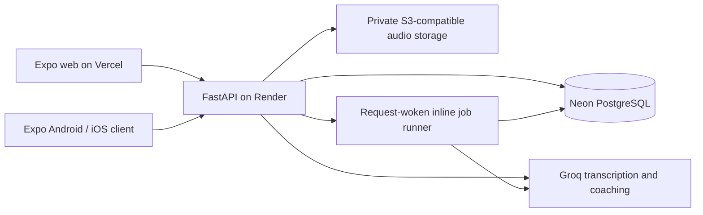

# Current application architecture

Source reviewed 15 October 2026 at baseline `10d27c6`. Scope: the deployed Expo/FastAPI application. The [earlier Dart/Supabase design](LEGACY_ARCHITECTURE.md) is a separate retained implementation.

The iOS client has simulator development coverage; current free iPhone distribution uses the web client. Local development substitutes SQLite and local audio files; Compose can run a separate generation worker. The Render configuration uses one API instance/worker and an inline job runner (`render.yaml`).

## Frontend boundaries

`apps/vaachak/src/app` contains Expo Router routes. Feature screens live in `src/features`, shared controls/audio in `src/components`, and typed API access and submission identities in `src/api`. `src/providers/Auth.tsx` owns authentication: native tokens use SecureStore; web tokens remain in tab memory. Account changes clear query caches and downloads.

Public quiz downloads use AsyncStorage and contain no private classroom material. Pending submission identities survive restart, but unsent answers/audio do not form a durable offline queue. Personal practice sessions are stored on the server and can resume through their API; temporary unsaved editor/recording state has narrower guarantees.

## Backend boundaries

| Module | Responsibility |
| --- | --- |
| `main.py`, `courses.py` | Authentication/authorization, classrooms, assignments, courses, attempt submission, audio access and knowledge routes |
| `db.py`, `postgres.py`, `migrations.py`, `postgres_schema.sql` | SQLite/PostgreSQL selection, database compatibility and schema lifecycle |
| `audio_store.py` | Local or private S3-compatible storage, temporary local materialization for processing, authorized/range responses |
| `feedback.py`, `ai.py` | Deterministic evaluation, Groq transcription/coaching, bounded provider fallback and result validation |
| `knowledge.py`, `knowledge_seed.py` | Versioned teaching units, explicit review/publication, skill/keyword retrieval and idempotent starter installation |
| `evidence.py`, `insights.py`, `operations.py` | Attempt identity/provenance, scored evidence, review recommendations, teacher follow-up and account operations |
| `growth.py` | Preferences, sessions, drafts, transcription preview, feedback reports, public downloads and scripted conversations |
| `generation_jobs.py`, `inline_worker.py` | Durable job state, leases, bounded retry/recovery and request-woken processing |
| `observability.py` | Sanitized error envelopes, request correlation and structured HTTP logs |

All module paths above are relative to `classroom_web/server/`.

## Attempt and AI data flow

1. The learner retrieves an authorized, versioned task. The client sends a logical submission UUID and task version for retry reconciliation.
2. Text/choice answers use the corresponding grading path. Audio is uploaded to the server, validated, and sent to Groq for transcription. The optional preview flow preserves original ASR separately from learner corrections.
3. Reading evaluation compares text; it is not acoustic pronunciation scoring. Deterministic grading is used where appropriate. Coaching can receive up to three relevant published teaching units selected by skill/domain and keyword overlap.
4. Provider output is validated; citations must refer to supplied teaching units. This constrains provenance, not the semantic truth of every model statement. Uncertain results are marked unscored and excluded from scored progress.
5. The database preserves the task snapshot, result, input/transcript basis, model/rubric information, retry relation and citation versions. Authorized history/audio endpoints expose the learner's evidence.
6. Review and teacher attention derive from eligible skill-specific evidence and delayed success. The deployed algorithm is not the separate Dart BKT engine.

`ai.py` uses Groq-hosted Whisper models for ASR and a configured/fallback chat-model list. Model availability and response provenance determine the actual model used; do not describe a single model as guaranteed for every attempt. Teacher AI drafts enter a review workflow, not automatic publication.

## Access, privacy and operations

Roles and resource ownership are enforced by FastAPI handlers/shared checks. Neon persistence does not automatically enable the separate Supabase row-level-security policies. Audio can persist remotely; this release does not promise that voice stays on the phone. Account export/erasure and configurable retention tools are implemented; an external cleanup/backup schedule still requires operations setup.

Responses carry request IDs; errors use a safe `detail` and structured `error` object. CORS is configured for permitted web origins. Logs omit credentials, answer bodies and raw audio. SMTP recovery is optional; its last recorded hosted configuration was unavailable.

The supported Render topology is one instance/worker. Inline AI jobs are persistent and leased but may be delayed by sleeping/restarting free infrastructure. See [deployment and recovery](../deploy/backend/README.md) for exact configuration and limits.
