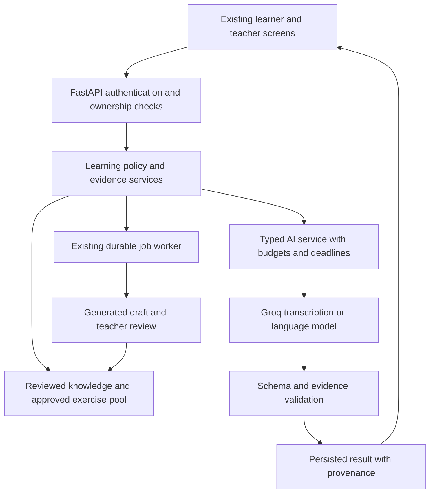

# Vaachak generative AI implementation plan

> Status reconciliation — 15 October 2026: this is the original planning document, not a current feature inventory. Read [implementation status](IMPLEMENTATION_STATUS.md), [architecture](ARCHITECTURE.md) and [dated verification](VERIFICATION.md) first. Hosted Render/Neon/Vercel deployment and a signed Android APK are delivered. G1/G2 feedback and teaching knowledge are integrated; remaining roadmap acceptance and human evaluation are separate. Historical statements below such as “not implemented” describe the planning baseline.

Date: 11 October 2026. Status: proposed implementation and acceptance plan. No feature described as proposed below is complete merely because it appears here.

Vaachak should help an English learner turn a real difficulty into an understandable correction, a useful practice task, and successful use in a new situation. Extend the existing FastAPI and Expo application incrementally. Preserve authentication, classes, courses, six exercise types, recorded attempts, teacher approval, and the current working learner journeys.

The first release should prioritize trustworthy feedback and useful next steps. Grounded explanations, adaptive practice, and responsive role-play then build on the same evidence. Continuous learning means learners can start another useful session without reaching a curriculum-imposed stopping point; it does not promise infinite unique material or unlimited model requests.

This plan extends [the product plan](REACT_NATIVE_PRODUCT_PLAN.md) and [the user value plan](USER_VALUE_IMPLEMENTATION_PLAN.md). It uses the current [implementation status](USER_VALUE_IMPLEMENTATION_STATUS.md) and [end-to-end report](verification/END_TO_END_TEST_REPORT.md) as its baseline. Existing release blockers remain acceptance requirements.

## 1. Product focus and differentiating experience

The initial audience is adult college learners preparing for interviews, project presentations, and workplace conversations, supported by teachers or placement trainers. This is the target hypothesis to validate, not completed user research.

The product promise is: “Practise something useful, understand your next improvement, and use it confidently in a new situation.” Its distinction should come from five connected capabilities:

1. Feedback that distinguishes transcription uncertainty from learner mistakes.
2. Explanations grounded in reviewed teaching material and linked to the learner's actual answer.
3. A visible path from correction to targeted practice to delayed transfer.
4. Realistic role-play tied to the learner's chosen goal.
5. Teacher control over generated curriculum and evidence behind recommendations.

Do not add a separate general-purpose chatbot as the main entry point. Place coaching beside the task where it is useful. Keep Today, Practice, Review, Progress, and existing teacher screens recognizable.

### Primary learner journey

| Step | User experience | System behavior |
| --- | --- | --- |
| Choose | Select interview, presentation, workplace, or everyday English; optionally choose interests and explanation language | Save explicit preferences; allow skipping personalization |
| Start | “Practise for five minutes” opens a short session | Select reviewed items using goal, due work, and evidence; show why |
| Speak | Record, listen, and confirm what was heard | Preserve original transcript, corrected text, input mode, and uncertainty separately |
| Understand | See one strength and one useful improvement; tap Explain if needed | Ground coaching in the answer, reviewed knowledge, and task rubric |
| Apply | “Try another example” opens a different task for the same skill | Select approved content; record an immediate practice attempt without claiming delayed mastery |
| Transfer | Use the skill in an interview or other role-play | Generate bounded contextual replies and evidence-linked feedback |
| Return | Revisit the skill later in a new context | Apply a versioned review policy and show delayed evidence |
| Continue | Choose another session, easier practice, a different goal, or revision | Keep useful reviewed practice available during provider outages or generation limits |

Example: a learner says “Yesterday I go to college.” If the confirmed transcript supports that error, the coach explains “went,” offers a different past-tense exercise, and later introduces past tense in an interview. If the discrepancy is only an ASR word-boundary issue, the app asks for confirmation or withholds that correction. Completing the immediate retry does not prove retention.

### Teacher journey

Choose a goal or add lesson text → generate a small draft batch → inspect source material, answers, and quality flags → edit and approve → publish within the intended class or public scope → inspect learner difficulties → retire or improve problematic content. Generation saves preparation time; teachers retain publishing control.

## 2. Existing assets and concrete integration points

| Existing location | Retain | Extend |
| --- | --- | --- |
| `classroom_web/server/ai.py` | Groq HTTP integration, configurable models, transcription, coaching, generation | Capability-aware schemas, typed results, retrieval context, bounded requests and usage metadata |
| `feedback.py`, `skills.py` | Word comparison, deterministic fallback, skill taxonomy | Transcription-aware normalization, evidence eligibility, grounded correction validation |
| `main.py` and `evidence.py` | Attempt submission identities, immutable snapshots, input provenance, rubric/policy versions | New result fields and append-only evaluation revisions; compatible old clients |
| `growth.py` | Profiles, personal sessions, downloads, confirmed transcripts, scripted conversations | Preferences, selection reasons, skips, AI-mode conversations and discovery |
| `insights.py` | Evidence-derived skill views and teacher attention | Shared evidence eligibility and transparent recommendations |
| `generation_jobs.py`, `tools/learning_worker.py` | Leases, quotas, worker recovery, review-required drafts | Operation types, content replenishment and content-validation jobs |
| `growth_migrations.py`, `db.py` | Ordered SQLite migrations | Additive schema changes, indexes, migration rehearsals |
| `apps/vaachak/src/features/Player.tsx` | Six activity formats, recording, transcript review, feedback | Confidence guidance, explanation panel, practice-next and reporting controls |
| `Learning.tsx`, `Growth.tsx` | Today, Review, Progress, goals, conversation and teacher saved work | Contextual recommendations, resume, role-play, personalization controls |
| `Composer.tsx`, `Courses.tsx` | Teacher drafts, editing, approval and publishing | Source-backed generation, reviewed pool admission, content version display |
| `operations.py`, `observability.py` | Lifecycle operations and request logging | New-resource export/erasure, retention and AI operational events |
| `postman`, API registry and generated client types | Existing contract workflow | Regenerate alongside each API change |

Important baseline constraints:

- Live speech upload and provider generation have evidence of working; feedback fairness still has a known “everyday/every day” defect.
- Personal review in `growth.py` uses 1/3/7/14-day intervals; classroom insights contain a separate 0/1/2/4/8/16-day policy. Define their scopes explicitly before adding a shared policy service. Do not silently reinterpret previous results.
- Personal practice currently selects a finite authored pool; generated teacher drafts do not automatically enter it.
- Conversation prompts are scripted. The current source contains four goal scenarios; older status prose lists three. Source and current tests should govern inventory updates.
- The current schema has migrations through version 5. Allocate subsequent versions at implementation time rather than assuming version numbers remain free.
- Some SQL inserts omit column lists, including learning-profile writes. Convert affected statements to explicit columns before adding fields.
- The root README still opens with historical frontend-removal wording although an Expo app now exists. Refresh this entry point as part of baseline documentation, without deleting useful historical records.
- Recorded checks include 152 backend tests, 19 frontend units, 66 browser journeys, additional regressions, and selected physical Android flows. These do not certify new AI behavior, full iOS coverage, or a production release.

## 3. Feasible architecture and boundaries

Keep one FastAPI application, SQLite, the existing worker, and the isolated Expo app for the initial deployment. Avoid introducing a new database service, agent framework, or training infrastructure before measurements justify it.

Use explicit retrieval and generation stages. The server decides what the model may see and what actions may be executed. The model can propose a skill, reply, hint, or exercise; it cannot grant content access, change scores retrospectively, publish material, or decide that a learner has mastered a skill.

Proposed module boundaries, introduced only as their milestone needs them:

- `ai_contracts.py`: typed provider inputs/results and versioned JSON schemas.
- `ai_policy.py`: model capability selection, deadlines, usage reservation and fallback policy.
- `knowledge.py`: scoped retrieval, source versions and citation resolution.
- `learning_policy.py`: evidence eligibility, selection and review scheduling.
- `content_quality.py`: answer checks, duplicate detection and approval state.
- `coaching.py`: explanation assembly and evidence-grounded feedback.
- `conversation_service.py`: turn state, recovery and bounded dialogue.

Preserve `ai.py` public functions as compatibility wrappers while extracting responsibilities. Do not turn `main.py` into the new orchestration layer or rewrite working endpoints wholesale.

## 4. Milestones, dependencies and effort

Effort is a planning estimate for one full-time engineer familiar with the repository, with educator review available each week. It excludes waiting for accounts, recruitment and hosting. The range is 17–25 engineer-weeks for the AI scope, plus approximately 2–4 weeks for unresolved release work. Re-estimate after G1. A 4–6-week pilot observation period can overlap later development but must finish before efficacy claims.

| Milestone | Effort | Dependencies | Acceptance outcome |
| --- | --- | --- | --- |
| G0 Baseline and evaluation setup | 1–2 weeks | Existing application | Reproducible baseline, rubric, fixtures and feature flags |
| G1 Fair feedback and AI contracts | 2–3 weeks | G0 | Known scoring defect fixed; uncertain evidence handled safely |
| G2 Reviewed knowledge and grounded coach | 2–3 weeks | G1 | Useful explanations with valid sources and ownership boundaries |
| G3 Teacher content supply | 2–3 weeks | G2 | Generated material reaches practice only through review |
| G4 Adaptive continuous practice | 2–3 weeks | G1, G3 | Meaningful next task, clear selection reasons and outage continuity |
| G5 Responsive role-play | 3–4 weeks | G1, G2; G4 for transfer integration | Recoverable contextual turns with bounded cost |
| G6 Language support and progress summaries | 2–3 weeks | G2, G4; G5 for dialogue summaries | Reviewed language support and evidence-linked summaries |
| G7 Pilot and AI operational acceptance | 3–4 weeks | G1–G6 | Measured quality, cost, usability and rollout decision |

G0–G4 form the recommended MTech core demonstration. G5 is the next differentiating increment; G6 may begin with one explanation language. The complete requested scope includes all milestones, but smaller accepted increments should ship independently. Existing reliability and signed-build work must run alongside this plan; AI features do not replace it.

## 5. G0 Baseline and evaluation setup

1. Reproduce core learner/teacher journeys with isolated data and record the current model, prompt, rubric and code versions.
2. Prepare a candidate corpus of 150–250 consented or licensed answer examples, including correct Indian English, common errors, ASR segmentation, silence, noise and incomplete answers. Separate text cases from audio cases. Keep a frozen holdout split by speaker and exercise family to reduce leakage.
3. Ask two English educators to define acceptable corrections, uncertain cases, and useful next tasks. Record disagreements and adjudication. Recruit 5–8 adult learners and 2–3 trainers for initial workflow interviews; this is qualitative discovery, not a population estimate.
4. Add server-controlled feature flags for grounded coaching, adaptive selection, AI conversations, and translated explanations. Existing behavior remains available for rollback, except known-bad scoring should not be deliberately served as a live experimental control.
5. Define operation-level AI metrics and baseline latency/cost measurements. Functional analytics consent remains distinct from operational logging and personalized learning state.
6. Establish an acceptance ledger with requirement ID, source changes, test evidence, reviewer, result and unresolved risks.

Exit: existing critical flows pass; the corpus has provenance and splits; rubric and initial targets are agreed; model outage and flag-off paths are reproducible. Full signed-build validation may remain in the parallel release track, explicitly recorded.

## 6. G1 Fair feedback and robust AI results

### Backend work

- Add `transcribe_detailed` while preserving string-returning `transcribe` for older call sites. Persist available ASR metadata, model and version without making metadata mandatory for local Whisper or older clients.
- Normalize case and punctuation consistently. Treat potentially equivalent spoken segmentation conservatively: do not globally join words or treat all homophones as equal. For reading, use reviewed boundary rules and contextual checks; ambiguous cases need confirmation or an unscored retry. Typed spelling remains a separate concern.
- Preserve original audio/text and user-confirmed corrections. Edited transcripts may support text coaching, but do not establish acoustic accuracy or unaided spoken mastery.
- Prevent the coaching model from reintroducing a spacing penalty suppressed by transcription-aware handling. Every correction must reference a span in the evaluated transcript and an allowed skill code.
- Add result fields such as `evaluation_status`, `uncertainty_reasons`, `evidence_eligibility`, `feedback_version`, and `normalization_version`. Keep existing score and result fields compatible; use an explicit unscored state for uncertain audio instead of an invented zero.
- Keep reading word accuracy deterministic, free-speaking coaching rubric-based, and objective answers deterministic. Label the basis of each result in the UI.
- Introduce typed structured outputs where the selected provider model supports them. Validate schema and semantics locally, allow at most one bounded repair, and fall back with an explicit source. Invalid responses must not enter evidence calculations.
- Separate provider errors from application validation errors. Use stable codes such as `audio_uncertain`, `provider_unavailable`, `invalid_ai_result`, and `budget_exhausted` with actionable messages.
- Store re-evaluations as new revisions. Never overwrite historical attempts or silently rewrite progress. Recompute eligible derived views when an attempt is disputed or superseded, using a recorded policy version.

### Frontend work

Extend Player with transcript confirmation, concise uncertainty guidance, one primary correction, expandable detail, and Retry/Type answer/Report feedback actions. Preserve recordings during an explanation failure. Show an unscored result clearly and keep the learner able to continue.

Exit: the reported spacing case passes without a false learner penalty; genuinely different words remain distinguishable; uncertainty and corrected-input cases cannot advance inappropriate skill evidence; malformed provider responses and outages preserve completion/recovery. A reviewed fixture set tests both false corrections and missed corrections.

## 7. G2 Reviewed knowledge and grounded coaching

Start with a small reviewed knowledge base: approximately 60–100 teaching units covering the existing priority skills, with examples relevant to the four goals. Each unit needs skill tags, intended level, explanation language, source/rights, version, reviewer, status, and visibility scope.

Retrieval implementation:

1. Filter by ownership/class access, approval, active version, skill, language and level before ranking.
2. Start with skill/tag matching and SQLite full-text search where FTS5 is available. Confirm support in the deployed SQLite build; a deterministic tag/keyword fallback must work without it.
3. Retrieve a small context, initially at most three concise units. Persist their version IDs with the result.
4. Evaluate retrieval coverage on held-out questions before adding embeddings. If keyword retrieval misses paraphrases, introduce a pinned embedding adapter and benchmark lexical versus hybrid ranking. No external vector database is required for the initial corpus.
5. If no suitable source exists, show a reviewed generic explanation or state that a teacher-reviewed explanation is unavailable. Do not invent a source.

Grounded coaching receives the current task, confirmed answer, eligible skill context and retrieved units. It returns a short explanation, one example, approved source IDs, and an optional next-action suggestion. Validate source IDs against the retrieved allowlist; render source titles through the server, not model-created URLs.

Player gains “Explain” and “Show example” within feedback. These actions must not submit another attempt. Today can display the next recommended activity, but a coach response cannot modify progress. Teacher-only or class-restricted source text must never enter public caches or another learner's response.

Exit: access-isolation tests pass; sources resolve to the correct versions; reviewed answers are useful and grounded; no-source and provider-offline paths remain usable. Start with retrieval precision/recall evaluation before claiming RAG improves quality.

## 8. G3 Teacher content supply and quality control

Extend the existing composer, generation jobs and worker rather than creating a second content system.

Initial scope: pasted lesson text and reviewed knowledge units. Add plain-text/Markdown import with size and encoding limits if needed. PDF/DOCX extraction and OCR are a later extension with separate parsing, malware/resource limits and source-preview acceptance; they should not block the core path.

Each generation request specifies goal, skill, difficulty, task types, source IDs, count and visibility. Produce a small batch, initially 3–6 tasks, and store its model/prompt/source versions. A worker failure leaves a recoverable draft job, not a published lesson.

Quality workflow:

1. Validate the six existing item schemas, answer indexes, option uniqueness and required content.
2. Check exact duplicates and normalized text similarity. Add embedding-based near-duplicate checks only after a labelled duplicate benchmark demonstrates value; calibrate thresholds rather than choosing an arbitrary universal cosine score.
3. Flag answer/explanation inconsistency, unsupported source claims and level mismatch. A second model can assist review for flagged batches but cannot serve as final approval or the sole correctness judge.
4. Present source passages, proposed answers and flags to the teacher for editing and approval.
5. Publish approved versions to the existing course/class destination. Admission to the shared practice pool requires a separate explicit visibility/approval action.
6. Track content reports, reviewer ownership, retirement and replacement. Retired content stops entering new sessions; historical attempt snapshots remain readable. Define how active sessions handle urgent withdrawals.

Prepare an initial coverage matrix across goal × priority skill × difficulty. Reviewed supply is a delivery dependency: if review capacity is insufficient, label revision and slow pool expansion instead of publishing unreviewed items.

Exit: no unapproved item appears in learner selection; answer keys remain server-owned; private source content stays private; edits create traceable versions; worker retries cannot duplicate pool entries; one full teacher creation-to-learner-practice flow passes per task type.

## 9. G4 Adaptive continuous practice

Use transparent selection rules first. A model may help phrase a recommendation; selection and mastery decisions should remain reproducible.

- Extend profiles with optional interests, explanation language and personalization opt-out. Use explicit preferences and learning evidence; do not infer sensitive traits from speech.
- Build a shared evidence eligibility function: disputed, immediate retry, provisional offline, uncertain ASR, and assisted responses have distinct roles. Exclude them from mastery claims when appropriate while still offering useful practice.
- Reconcile personal and classroom review through named policy scopes. Keep legacy timelines until explicitly migrated. A proposed persisted review state must remain rebuildable from versioned eligible events.
- For an initial five-task session, aim for two due-review items, two goal/skill-targeted items, and one transfer or exploration item when supply allows. This is a tunable hypothesis, not a scientifically established ratio. Record actual reasons and substitutions.
- Permit Easier, More challenging, Change topic and Skip with optional reason. Skipping is neither an incorrect attempt nor evidence of mastery. Preserve session identity and immutable answered-item snapshots.
- Use the least recently exposed eligible content when new content is unavailable. Queue replenishment based on aggregate coverage gaps; do not call generation synchronously for every learner tap.
- Increment difficulty only with sufficient relevant delayed evidence; let the learner override comfort level. Show “suggested challenge,” not a certified CEFR level.
- Update Today, Review and session completion with one clear next action and a short “Why this practice?” explanation.

Exit: no dead end when a course or session finishes; no false novelty claims; sensible behavior for cold starts, sparse history, exhausted pools and provider limits; deterministic replay of selection decisions; learner changes do not corrupt submissions or schedules.

## 10. G5 Responsive role-play

Build bounded text-and-recorded-audio turns first. Reuse current conversation ownership, revisions, idempotent turn IDs and transcription preview. Preserve scripted mode as a supported fallback. Real-time duplex speech and custom neural voices are outside the first release.

Provide interview, presentation, workplace and everyday scenarios with reviewed objectives, opening prompts, level constraints and completion criteria. A session initially targets 6–8 exchanges; the learner can finish early or start another session. This bounds each request and avoids a curriculum stopping point.

Server-controlled context contains the scenario, confirmed current turn, a small recent-turn window, a compact summary and explicitly selected skill targets. Preserve exact recent evidence references; generated summaries are not authoritative learner memory. Keep role-play reply generation separate from final pedagogical evaluation to reduce unnecessary per-turn calls.

Turn processing must reserve a unique request before provider I/O, release the database transaction, generate and validate, then commit with revision/lease checks. States should distinguish queued, running, completed, failed and cancelled. Duplicate or timed-out requests reconcile to the same persisted result. A provider may bill an uncertain timed-out request even when the app prevents duplicate visible replies; record this operational limitation.

Use structured response fields such as reply text, optional hint, objective coverage and proposed finish. The server validates the response and enforces session limits. If future tool calls are added, allow only scoped operations such as retrieving a teaching example; do not expose arbitrary SQL, URLs or filesystem actions.

Frontend additions: scenario cards, saved-session discovery, Resume, Record/Type, transcript confirmation, optional hint, Finish, Retry reply and a focused summary. If optional device speech synthesis is used, verify it per platform and keep text fully usable. Never claim acoustic pronunciation accuracy from transcript-only evaluation.

Exit: replies respond meaningfully to the user's last answer; scripted fallback is explicit; background/kill/retry/concurrent-turn cases do not lose or duplicate turns; budgets work; completion summaries cite actual evidence and cannot fabricate proficiency scores.

## 11. G6 Language support and useful progress

Start with English plus one educator-reviewed explanation language, then add the second after quality evaluation. Hindi and Marathi are candidate priorities to validate with the initial cohort. Keep practice targets in English while translating explanations and interface text appropriately.

- Add a centralized localization structure and tested language preferences; do not scatter translation conditions throughout feature screens.
- Use reviewed bilingual knowledge units where available. For generated translation, preserve the quoted learner phrase, corrected English and skill meaning. Flag missing reviewed coverage and fall back visibly to English.
- Test font rendering, text expansion, screen-reader labels and language switching on native and web layouts.
- Compute progress counts, intervals and comparisons in code. Give a language model only scoped structured facts and evidence IDs to phrase a brief summary.
- Require each progress claim to reference valid evidence. Distinguish immediate improvement, delayed success and insufficient evidence. Do not aggregate incompatible rubric versions as if scores were directly comparable.
- Add “Why this recommendation?”, useful/not useful feedback, and inspect/reset controls for personalization. Resetting preferences must not silently erase assessment history; provide explicit scope choices.

Exit: reviewed language examples preserve teaching meaning; no invented numbers or achievements; summaries update after disputes/retirement where applicable; preferences and derived personal data participate in export/erasure.

## 12. Proposed data and API changes

These are design contracts, not a claim that routes or tables already exist. Final names should follow the repository's API conventions. Prefer typed response models to unrestricted dictionaries for new AI workflows.

| Proposed data | Purpose and constraints |
| --- | --- |
| Profile preference fields | Optional interests, language and personalization state; explicit column writes and safe defaults |
| `knowledge_units` and versions | Reviewed text, scope, owner/class, source rights, skill tags, reviewer, status |
| Content pool membership and provenance | Reference existing approved item versions; avoid duplicating course ownership and publish state |
| `ai_runs` | Operation, request identity, status, model/prompt/schema versions, duration, usage, source IDs and sanitized failure code |
| `attempt_evaluations` | Append-only result revision, eligibility and rubric versions; canonical active revision resolved server-side |
| `review_state` and selection decisions | Rebuildable due state, named policy scope/version, evidence cursor and selection reasons |
| Conversation turns | Normalized owned turns, unique client IDs, revisions, processing states and confirmed transcription references; migrate old JSON sessions carefully |
| User-scoped cached results | Scope, source versions, TTL and input digest; separate from reusable public content caches |

| Route | Proposed change |
| --- | --- |
| `POST /api/transcriptions` and existing read route | Add optional quality/provenance fields without removing the transcript contract |
| `POST /api/attempts` | Add versioned evaluation fields; preserve submission identity and existing callers |
| `POST /api/attempts/{id}/coach` | Owned attempt explanation/example request, constrained intent, language and client UUID |
| `GET /api/attempts/{id}/coach/{request_id}` | Recover the persisted explanation status/result after timeout |
| `GET/PUT /api/me/learning-profile` | Extend explicit preferences with backward-compatible defaults |
| `POST /api/me/practice-sessions` | Support target-skill/context options and return validated selection reasons |
| `POST /api/me/practice-sessions/{id}/skip` | Revision-checked, idempotent replacement/advance action; never a scored attempt |
| `GET /api/me/learning-summary` | Evidence-scoped factual summary with optional generated wording |
| `POST /api/ai/jobs` | Add backward-compatible teacher job options for source-backed generation |
| `POST /api/teacher/knowledge` | Create private source/knowledge draft; no implicit public sharing |
| `POST /api/teacher/knowledge/{id}/review` | Review/approve only within authorized ownership and scope |
| `POST /api/teacher/content-pool` | Admit an approved item version with explicit publication scope |
| `GET /api/conversations` | Discover owned saved sessions |
| Existing conversation create/turn/read routes | Add optional mode; preserve scripted clients; AI turns expose processing state |
| `POST /api/conversations/{id}/finish` | Idempotent finish and recoverable summary generation |

Do not repurpose a previously required field or HTTP success shape for asynchronous behavior. If a client cannot accept a pending turn, retain the legacy scripted contract and introduce an explicit AI-mode operation or versioned route. Return stable error codes and request IDs using existing conventions. Honor `Retry-After` for rate limits; never expose provider credentials or raw provider errors.

Add migrations with backup/restore rehearsal and data-preservation tests. Update affected exports, erasure, retention, OpenAPI, Postman, generated TypeScript, API registries and client adapters in the same milestone. Index ownership/status/due queries and verify query plans before expanding data volume.

## 13. Cost, latency and operating limits

Use a fixed workflow over approved retrieval and typed model calls. This is consistent with the preference for simple, composable workflows for well-defined tasks in [Anthropic's engineering guidance](https://www.anthropic.com/engineering/building-effective-agents); it does not require adopting its models or an agent framework.

Initial engineering budgets, to validate rather than advertise as achieved:

| Operation | Initial bound | Degraded behavior |
| --- | --- | --- |
| Objective grading and session selection | No model call; target p95 under 1 second at pilot load | Existing deterministic exercise/review |
| Speaking evaluation | One transcription plus one coaching call; cap pilot recordings at 60 seconds | Retry transcription or type; rules with explicit source where valid |
| On-demand explanation | One short call, initially up to 500 output tokens and three sources | Reviewed explanation, or preserve original feedback |
| Role-play | One reply call per accepted turn, initially up to 300 output tokens; 6–8 exchanges | Resume later or explicit scripted alternative |
| Teacher content | 3–6 items per queued batch, one bounded repair at most | Editable draft or retryable job failure |
| Progress summary | Generate only when evidence changes; cache per user/version | Deterministic factual summary |

Initial UX targets: p95 coach/role-play response within 8 seconds and a short recording's transcription-plus-feedback within 15 seconds on the specified test network/load. Existing provider timeouts are longer; measure first, then add bounded background recovery when the interactive wait budget is exceeded. A timeout must not imply a failed submission when processing may still complete.

Reserve per-user and global operation budgets transactionally before network calls; reconcile actual usage after completion and handle crashed reservations. Limit simultaneous calls and queued work. Do not hold SQLite write locks during provider I/O. Record queue age and lock contention. If measured multi-instance/high-write needs exceed SQLite's safe operating envelope, migrate storage in a separately scoped release; do not assume adding API replicas is safe.

Calculate session cost from recorded token usage, audio duration and provider/model rate snapshots:

`session cost = input token cost + output token cost + transcription cost + embedding cost + shared generation cost allocated per use`

Choose a pilot budget with the project owner after measuring representative sessions. Use explicit spending limits in configuration and never promise an unmeasured rupee cost. Prefer a smaller capable model only if held-out quality meets the same gates. Escalate ambiguous cases selectively; a large model on every request is not the default.

Keep static prompt material before dynamic user content where supported. Provider prompt-cache hits are not guaranteed; application reuse of approved content remains the dependable optimization. See [Groq prompt caching](https://console.groq.com/docs/prompt-caching).

Public content caches may be shared only for public approved material. Personal feedback caches must include owner, input/evidence version, model, prompt, language and source versions, and be removed or invalidated on relevant lifecycle changes.

## 14. Reliability, privacy and operational evidence

- Treat transcripts and source documents as untrusted subject matter. Delimit inputs; prohibit them from overriding workflow rules; validate model-proposed IDs and actions server-side.
- Enforce authorization before retrieval and again when resolving cited content. Teacher access must follow current class membership and existing evidence rules.
- Keep API keys server-side. Log request/operation IDs, model and policy versions, duration, token counts, cache status and sanitized error categories; exclude raw audio, full transcripts, personal document text and secrets from general logs.
- Explain cloud processing in the recording/coaching flow. Use licensed or consented material for research/evaluation; raw learner recordings must not become a shared training or retrieval corpus by default.
- Define retention for new runs, temporary audio, source uploads and dialogue history. Extend export/erasure, cache invalidation and backup-expiry procedures; withdrawing consent must not leave untracked derived copies.
- Include denial/revocation of microphone permissions, flaky networks, repeated taps, worker crashes, expired leases and uncertain responses in feature acceptance.
- Keep the typed-answer and existing practice paths usable when AI fails. Do not silently convert an AI conversation into a scripted one mid-turn.
- Schema constraints are an interface guarantee, not a correctness guarantee. Verify supported models at implementation time and maintain semantic checks. [Groq structured outputs](https://console.groq.com/docs/structured-outputs)
- ASR segment metadata can help identify uncertain transcription but is not a calibrated learner-confidence or pronunciation measure. Calibrate thresholds on representative audio. [Groq speech-to-text metadata](https://console.groq.com/docs/speech-to-text)

## 15. Effectiveness evaluation and acceptance targets

Targets below are proposed initial gates, not measured outcomes. G0 should freeze them before held-out evaluation. Report sample sizes, confidence intervals where applicable and performance by relevant subgroup; do not hide uncertainty behind aggregate percentages.

| Dimension | Proposed acceptance method |
| --- | --- |
| Feedback fairness | Zero failures on the known segmentation regression set; false corrections on teacher-labelled correct answers at or below 5% on holdout; separately measure missed-error rate so abstaining on everything cannot pass |
| Coaching usefulness | Two independent educators rate at least 90% of sampled explanations correct and actionable; adjudicate disagreements and report agreement |
| Grounding | At least 95% of sampled knowledge claims supported by the cited passage; all returned source IDs valid and authorized; report retrieval misses separately |
| Content quality | All published items explicitly approved; no unresolved answer-key errors in acceptance fixtures; report teacher rejection rate and editing time |
| Adaptive practice | Every selected item has a reproducible reason; none uses disallowed evidence; review/transfer coverage audited by educator |
| Conversation quality | At least 90% of reviewed turns relevant to the latest answer and scenario; zero authorization/state corruption in automated failure tests |
| Progress accuracy | All numbers match stored evidence; zero unsupported mastery claims in reviewed acceptance samples |
| User experience | At least 80% of an initial 10–15 observed learners complete the first useful practice unaided within five minutes; report task failures, not just averages |
| Reliability and cost | Critical E2E flows pass; no duplicate visible submissions/turns under retries; measured latency and spend within the configured pilot envelope |

MTech study design: compare the enhanced system with the current approach using a frozen offline benchmark, then run a consented 4–6-week feasibility pilot, initially around 20–30 adults if recruitment permits. That cohort is a practical starting point, not a claim of adequate statistical power. Use matched exercise difficulty and blinded educator scoring; calculate a sample-size requirement before making confirmatory efficacy claims.

Primary learning outcome: change in performance on unseen equivalent tasks after a delay, preferably about seven days. Secondary outcomes: false correction rate, immediate task success, voluntary return, user-rated usefulness, teacher preparation time and cost per completed useful session. Report attrition and actual return denominators. Engagement alone is not learning.

Use offline ablations to isolate contributions: current feedback versus transcription-aware feedback; ungrounded versus retrieved coaching; current selection versus evidence-based selection. Live comparisons should not knowingly expose participants to the existing unfair scoring defect. Keep prompts and holdout data separate, and do not use an LLM judge as the only evaluator.

## 16. Testing and release acceptance

Every milestone needs three forms of evidence: deterministic tests, a bounded live-provider check, and reviewed product behavior. Do not mark a milestone complete from mock tests alone.

Backend coverage: ownership, source visibility, schema validation, provenance, idempotency, revisions, quota races, deleted accounts, content withdrawal, migration preservation and worker recovery. Use frozen provider fixtures for CI and separately labelled live checks for capability, latency and quality.

Frontend coverage: learner and teacher happy paths plus empty/loading/error/offline/expired-auth states for every new control. Test repeated taps, dismiss/back, unsaved edits, language changes and resuming after interruption. Reuse Playwright and native test infrastructure; verify Android and iOS in addition to responsive web.

AI adversarial coverage: instructions embedded in transcripts/documents, invented source IDs, incorrect skill codes, unsupported claims, truncated JSON, contradictory answers, model refusal, quota exhaustion and fallback selection. Include multilingual and correct Indian English examples without asserting uniform performance across all dialects.

Release sequence:

1. Feature flags off by default; run schema migrations against copies and restore a backup.
2. Internal accounts exercise the new workflow and its fallback; confirm observability and actual model capabilities.
3. Admit a small consenting cohort; review flagged feedback and operational metrics daily during initial rollout.
4. Expand only after the milestone's quality/cost gates and signed-build critical journeys pass.
5. Disable the affected AI feature on severe incorrect-feedback, authorization or cost regressions; preserve sessions and the stable fallback. Roll back application behavior without destructive schema downgrades.

Parallel release requirements remain: full current iOS regression, physical Android header confirmation, signed-build reminders and permissions, SMTP delivery/deep links, HTTPS staging, secrets setup, backup/retention scheduling, restore drills, mixed-traffic load tests and accessible native layouts. These are not completed by this plan.

## 17. First implementation increment and completion definition

Begin with G0 and G1 in this order:

1. Add the known ASR boundary case and genuine-word-difference counterexamples to a reviewed regression corpus.
2. Define evidence eligibility and uncertainty contracts without changing current successful submission identities.
3. Add detailed transcription metadata through a compatible adapter.
4. Fix deterministic comparison and ensure model coaching cannot reintroduce the false correction.
5. Add explicit uncertain/unscored presentation and recovery actions in Player.
6. Test old clients, web, Android recording and iOS recording; record live evidence separately from fixtures.
7. Freeze the initial rubric and compare results on holdout before enabling new personalization.

Each milestone is complete only when source changes, migrations, APIs, client flows, lifecycle handling, logs, fallback, tests and acceptance evidence agree. The final deliverable includes reviewed content, evaluation datasets with permitted provenance, reproducible experiment scripts, deployment instructions, operational limits and an updated status ledger. The distinct academic contribution is the evaluated combination of fair transcription handling, grounded coaching and evidence-based transfer practice—not the number of model calls or a claim to have trained a new foundation model.
