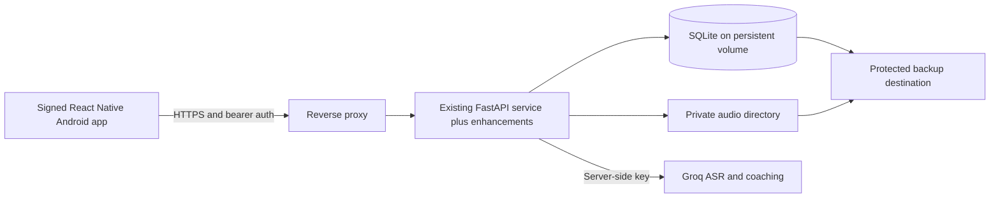

# VaachakAI M.Tech final year project and deployment plan

> Follow-on execution plan: [User value, retention and continuous learning](USER_VALUE_IMPLEMENTATION_PLAN.md) maps the implemented app to the next milestones. Existing verification reports remain the source of completed-work claims.

Reframed: 11 October 2026. Proposed project title: **VaachakAI: An Explainable Adaptive English Practice System with Teacher-Guided Intervention**.

This is the final-year project specification for incrementally enhancing the existing VaachakAI implementation and delivering a deployable React Native application. It replaces the earlier startup-oriented launch plan. The intended outcome is a working, evaluated software system with a defensible technical contribution, a hosted backend, an installable Android release, and reproducible academic evidence.

**Status:** this document is a plan. Existing code and previously observed test results are identified separately from proposed enhancements. Reframing this document does not make the project deployment-ready or implement the enhancements. University-specific dissertation, publication, ethics, and marking requirements must be checked with the supervisor; none is assumed here.

## 1. Problem statement and project scope

Learners can complete English exercises without knowing which skill to practise next. Teachers can see activity totals without a consistent view of the evidence behind a learner's difficulty. In speech-based practice, transcription errors and typed responses can also be mistaken for evidence of speaking ability. The present application already supports classroom tasks, speech transcription, feedback, review, and teacher insights, but its evidence and progress semantics need improvement.

The project will close that gap through an **explainable practice loop**:

**Attempt → identify one relevant skill → provide feedback → retry → revisit with a different task after a delay → show the teacher the supporting evidence.**

The primary academic contribution is an implemented and evaluated policy for selecting review tasks and teacher follow-up using skill-specific, traceable evidence. Supporting contributions are reliable attempt identity, preserved content versions, clear feedback provenance, and a usable mobile interface. These extend the existing rule/AI pipeline; they do not require training a speech model or replacing the backend.

### Intended users and evaluation cohort

Retain teacher, student, and independent learner roles. Recommend a first deployment/evaluation cohort of **18+ college learners and English instructors**, especially learners comfortable with Marathi or Hindi who want foundational English practice. This is a practical study-scope choice for a university project, not a claim that the product has been validated for that market. It changes the evaluation cohort, not the existing classroom/course model. Use `standard=adult` where appropriate.

Use English learning content first. Marathi/Hindi guidance can improve accessibility; require reviewed translations before claiming either is fully supported. The current catalog has seven English sets and empty entries for the other listed languages. School use remains a future application; enrolling minors requires an appropriate consent and safeguarding workflow that is not implemented in the current FastAPI service.

The core jobs remain concrete: the learner needs a short useful task and understandable feedback; the instructor needs to inspect evidence and assign relevant follow-up. The examiner needs to reproduce the deployment, distinguish reused code from new work, and inspect measurements supporting the contribution.

### Project objectives

| ID | Objective | Required evidence |
|---|---|---|
| O1 | Deliver complete learner and teacher workflows in React Native | Installable Android release; real-device end-to-end tests |
| O2 | Improve skill-specific review and intervention over the existing heuristic | Versioned policy, baseline comparison, edge-case tests, reproducible experiment |
| O3 | Make learning evidence traceable and honest | Stable item versions, input provenance, linked retries, accessible attempt history |
| O4 | Make submission and progress reliable | Concurrent retry deduplication, content-change tests, coherent teacher views |
| O5 | Deploy and operate the existing service reproducibly | HTTPS deployment, persistent data, CI checks, backup/restore and rollback evidence |
| O6 | Evaluate quality and limitations | Human feedback ratings, speech benchmark, usability results, latency/cost and failure measurements |

## 2. What remains and what changes

| Existing component | Decision | Bounded enhancement |
|---|---|---|
| FastAPI routes and auth | Retain as authoritative service | Add response contracts, deployment controls, recovery and lifecycle support |
| SQLite schema and audio directory | Retain for the single-instance project deployment | Versioned migrations, new evidence fields/tables, persistent volume, tested backup |
| Groq ASR/coaching and deterministic rules | Retain | Record provenance/version; bound failures/cost; evaluate against rules-only baseline |
| Six task types and English catalog | Retain | Add stable item IDs, reviewed skill metadata and parallel assessment prompts |
| Classes, assignments, courses | Retain | Preserve history, align permissions/evidence views, improve mobile access |
| Review and attention modules | Extend in place | Skill-relevant evidence, delayed review rules, explainable ranking and follow-up lifecycle |
| Postman and Python tests | Retain and extend | Regression, compatibility, deployment and failure-scenario suites |
| Removed web/Flutter frontends | Keep removed | Implement one React Native frontend against existing APIs |
| Remaining Dart/Supabase components | Preserve as separate repository components | Document provenance; no second live progress store or required port in this release |

Do not make a database migration to PostgreSQL, a microservice split, a new auth provider, or an offline model runtime a prerequisite. Such changes would expand scope without proving the selected contribution. Preserve the current `/api` routes and response fields where safe; document deliberate behavior changes instead of concealing them behind a compatibility claim.

### Required final submission versus extensions

**Required:** all six task types; class and course participation; learner feedback/retry/history/review; teacher evidence and targeted assignments; reviewed AI drafting; skill-aware policy; reliable persistence; Android release; hosted single-instance service; basic account recovery and data lifecycle; evaluation scripts, results and dissertation evidence.

**Optional after required gates pass:** Marathi/Hindi guidance beyond reviewed core strings, reminders, richer tablet course editing, iOS distribution, full offline synchronization, and public content discovery. The UI must still allow teachers to manage core courses, units and lessons; only richer bulk/tablet tools are optional.

**Outside final-year scope:** organization billing, parent portals, enterprise SSO, social networking, multi-tenant administration, a new foundation model, calibrated phoneme scoring, unrestricted real-time conversation, and claims of million-user scalability. These can appear in future work, not as unfinished required modules.

## 3. Research grounding and academic contribution

The earlier desk research remains useful context. [ASER 2023](https://asercentre.org/wp-content/uploads/2022/12/ASER-2023-press-release1_English_16-Jan.pdf) documents varied English reading ability and unequal personal smartphone access among surveyed rural adolescents. It motivates simple instructions and shared-device awareness, but is not direct evidence about the proposed adult college cohort. [ELSA for schools](https://tw.elsaspeak.com/b2b/school-en/) and [Speak](https://www.speak.com/) already describe classroom monitoring or personalized speaking practice. Neither a dashboard nor AI feedback alone establishes novelty.

No end-user interviews or academic novelty review have been completed in this reframing. Before finalizing the dissertation claims, build a related-work matrix covering adaptive language practice, spaced review, explainable educational recommendations, human-in-the-loop feedback, and ASR-related assessment errors. For each primary paper, record population, method, dataset, evaluation, limitations, and the exact difference from this project. The current competitor/market sources do not substitute for that review. Do not describe the system as the first of its kind or guarantee publication.

### Proposed technical contribution

Implement an **evidence-aware review and intervention policy** in the existing `insights.py`/`skills.py` structure. Its distinct project-level value is the combination of:

1. Skill-specific success and failure evidence instead of allowing any clean answer to clear any earlier weakness.
2. Separation of typed practice, spoken submissions, transcription disputes, immediate retries, and delayed transfer evidence.
3. A transparent recommendation with reason codes, supporting attempt IDs, content version, and the next teacher/learner action.
4. An evaluated closed loop from recommendation to targeted assignment to follow-up evidence.

This is a testable engineering and applied-research contribution. Whether it is publishably novel requires the related-work review and results. Do not call an arbitrary weighted ranking a new machine-learning model.

### Policy specification to implement

- Attach reviewed `skill_ids` and an optional `primary_skill_id` to each immutable task version. A multi-skill task needs skill-specific feedback; do not treat a whole-task score as success on every tagged skill. Untagged historical tasks remain usable but cannot manufacture skill mastery.
- Persist `input_mode`, `transcript_origin`, feedback `source`, `rubric_version`, policy version and retry relationship. Treat ASR confidence as unknown unless the actual provider response offers a validated usable measure. Human confirmation is a user assertion, not an acoustic measurement.
- Exclude duplicate requests, withdrawn/disputed evidence, and unavailable source tasks from recommendation calculations. Typed answers may inform relevant grammar practice; they cannot establish spoken improvement.
- Immediate retries can improve the current task result but do not advance delayed-retention evidence. Require success on a different reviewed task testing the same skill after a documented interval before marking that skill as showing retained improvement. Start with a 24-hour interval for the experiment and report sensitivity to that choice; it is an experimental parameter, not a proven optimal interval.
- Preserve existing Leitner-style intervals for scheduling where possible. Make advancement depend on eligible spaced evidence; do not replace the review system with an unrelated algorithm.
- For task selection, use an inspectable initial priority: `0.5 × recent_skill_error_rate + 0.3 × normalized_overdue + 0.2 × unreviewed_evidence_gap`. Error rate uses the most recent five eligible skill observations; unknown evidence is labeled separately. Overdue is clamped to 0–1 relative to the configured due interval, using a minimum one-day denominator for immediate-review items. Evidence gap is 1 when there is no eligible delayed check after a correction, otherwise 0. Filter by access and task suitability before ranking; break ties by oldest due time and stable ID.
- Treat these weights/window sizes as a fixed starting hypothesis. Tune only on development data or keep them fixed; never tune on the held-out evaluation results. Compare with the existing scheduler and a simple due-date ordering baseline. If weighted ranking provides no benefit, report that and retain the simpler correct method.
- Return structured reasons such as `repeated_skill_error`, `delayed_check_due`, or `insufficient_evidence`, with counts and attempt references. Display ordinary language in the app. Do not expose “weakness” labels when there is no evidence.

### Research questions

| Question | Baseline and comparison | Measurement |
|---|---|---|
| RQ1: Does skill-aware review select more relevant follow-up tasks? | Existing review/skill logic, due-date ordering, proposed policy | Instructor-rated relevance@3 and invalid/stale recommendation rate |
| RQ2: Does hybrid feedback improve usefulness over rules alone? | Rules-only versus current rules-plus-Groq on identical eligible inputs | Blinded ratings of correctness/actionability, latency, provider cost |
| RQ3: Does linked evidence help instructors act more efficiently? | Existing summary workflow versus evidence-plus-follow-up workflow | Task completion, time, errors, instructor explanation of chosen action |
| RQ4: Is the enhanced deployed system reliable under the declared workload? | Fresh deployment and controlled fault scenarios | Duplicate count, success/error rate, p50/p95 latency, persistence and restore results |

Learning improvement is an exploratory outcome unless recruitment and study duration permit an adequately designed controlled study. API success, repetition gains, and user satisfaction are not interchangeable with learning efficacy.

## 4. End-user study and standout experience

Run brief formative discovery with approximately 6–8 adult learners and 2–3 instructors before final screen implementation. Ask them to demonstrate actual learning/feedback workflows, phone access, recording context and where correction becomes confusing. Test class joining, one spoken task, transcript mismatch recovery, review selection, and instructor follow-up. Use the results to adjust labels and task length, not to create a second product.

The intended experience is distinctive through practical details: one correction at a time, visible transcript/source, linked first and retry attempts, explanation of why a task is recommended, and a teacher action tied to subsequent evidence. Prefer private progress and familiar learning contexts over leaderboards or unexplained scores.

Retain the following limits in product copy and the dissertation: scores are task-specific; transcript matching is not acoustic pronunciation scoring; existing A1–C2 course labels are author metadata, not a validated placement test; source-language UI support is not proof of multilingual feedback quality; server rules fallback is not offline mobile operation.

## 5. Product boundaries and navigation

One React Native app with role-specific routes. The authenticated server role determines permissions. The UI choice “I’m learning” or “I’m teaching” does not grant additional authority. Existing accounts have one role; multi-role switching requires backend design.

**Learner tabs:** Today, Practice, Class, Progress. Profile/settings opens from the avatar. Today combines a primary assignment/resume action, due review, and a small completion summary. Practice contains catalog and available courses. Class contains joined classes and teacher work. Progress presents participation and task-specific evidence, not an overall proficiency certificate.

**Teacher tabs:** Today, Classes, Library. Profile/settings opens from the avatar. Today prioritizes attention actions; Classes holds rosters and assignment progress; Library holds own courses, recordings, and reusable task sets. Mobile authoring should favor a short assignment; full course editing should use a tablet-friendly layout in the same React Native app.

Hide teacher-only tools from learners. Hide empty learning-language catalogs rather than implying ten supported teaching languages. Keep a child’s performance and audio out of public rankings. Do not add social feeds, public profiles, leaderboards, payments, a parent portal, or unrestricted chatbot conversation to the first release.

### Screen specification

| Screen | Main content and primary action | Required states and dependencies |
|---|---|---|
| Welcome and access | Brief value explanation, learning/teaching entry, sign-in/register | Email/password works today; classroom-managed identities are pending. Language choice initially stored locally. |
| Join class | Code field; show returned class identity after joining | Invalid/rotated code, already joined, loading. No public class-name preview endpoint currently. |
| Today | One “Continue” card, review count, other assigned work | New user, no assignments, all caught up, stale cached view. Aggregate existing calls initially. |
| Class work | Class switcher; assignment cards with title, deadline, item count, completion | Empty roster/work, removed membership, past due. Deadline is not a server-enforced submission cutoff. |
| Assignment introduction | Teacher instructions, audio if present, estimated effort if authored | Audio unavailable, recording-only assignment has no completion event today. |
| Task player | One task, clear progress, context-sensitive input | Six task types below; lock, permission, connection, validation states. |
| Feedback | Transcript, source-appropriate result, one correction, retry | Recognition mismatch, rules fallback, unclear result, no audio. |
| Session finish | Work completed, what to practise next, return to Today | Counts are completion, not mastery. Cross-task session persistence is new. |
| Review | Due items, why revisiting them helps, start next | Empty, source removed, source locked/unavailable, stale content. |
| Course outline | Units, lesson state, resume | Published/accessible only; open/locked/done states come from API. |
| Progress | Practice days, task categories, recent evidence | No evidence differs from low score; UTC streak limitation until fixed. |
| Teacher Today | Class selector and ordered attention cards | Empty queue, no learners, evidence unavailable; do not imply automatic diagnosis. |
| Learner detail | Relevant attempts, audio, recurring issue, assign follow-up | Existing detail is assignment-only; course evidence integration is pending. |
| Assignment composer | Choose class/one learner, task template, instructions, due date, preview | Review generated items; prevent double publish; draft persistence needed. |
| Course editor | Course → units → lessons → preview → publish | Changes to published content need versioning or edit restrictions. |
| Settings | Language, microphone help, account/session, privacy controls | Recovery and export/deletion must work by release; hide incomplete controls during development. |

## 6. Detailed user journeys

### A. First useful practice

Learner signs in, joins via class code, opens a short teacher assignment, sees a plain-language instruction, and requests microphone access only after tapping Record. They make a short recording, replay it if wanted, and submit. Feedback explains what was heard and offers one next action. The learner retries or finishes, then sees the next available task.

API sequence: `/api/auth/register` or `/login` → `/api/me` → `POST /api/classes/join` → class assignments → assignment detail → `POST /api/attempts` → refreshed assignment/stats. All API routes in this document use `/api` unless written in full.

Current compatibility: one multipart submission both transcribes and grades. There is no pre-grading transcript-confirmation step. For the required release, show the returned transcript and allow re-recording; do not pretend an “edit transcript” control corrects the original scored attempt. A typed alternative is supported technically, but the backend must persist its input mode before it is mixed into speaking evidence.

Target to validate: most recruited learners can reach and understand first feedback without assistance. Use an initial usability gate of at least 80% task completion; this is a proposed threshold, not a measured result.

### B. Daily practice and returning after a missed day

Today prioritizes unfinished teacher work, then due review, then an optional catalog/course task. Start with a proposed 3–5 minute session, not a requirement to maintain a streak. On return after absence, say “Continue where you stopped.” Due dates and review dates should use local presentation. Do not show a punitive lost-streak screen.

Existing dependencies: classes, assignments, `/api/me/review`, catalog, course state, and stats. There is no unified Today endpoint, notification scheduler, saved personal goal, or durable session plan. Compose a bounded number of calls initially; add a Today response if measured request fan-out warrants it.

### C. Six supported activity types

| Type | Learner interaction | Submission and honest result |
|---|---|---|
| `read` | Read a displayed sentence; record/replay | Audio-only for actual ASR; transcript match is not acoustic pronunciation accuracy. |
| `free` | Answer a bounded prompt in own words | Audio or text; show coaching and an example, never label model score a validated fluency measure. |
| `build` | Tap tokens into order; accessible move controls | Submit assembled text as transcript. Speech is optional and not needed to complete this interaction. |
| `choice` | Select one answer | Submit option index; correct answer is graded server-side. |
| `fill` | Choose the option filling the blank | Submit option index; render blank and options clearly. |
| `listen` | Hear a sentence, then choose the matching option | Device TTS or reviewed audio playback is needed; current server supplies text, not generated TTS audio. |

Keep options accessible without drag-only controls. For listen tasks, offer an explicitly labeled accessible alternative; if the text is revealed, do not count that result as equivalent listening evidence. Voice availability and pronunciation vary by device and must be tested.

### D. Correction, retry, and later transfer

Example: learner says “She go to school.” Show the actual transcript, a correction “She goes to school,” and a concise explanation appropriate to the learner. Offer Retry. Later use a different subject/sentence for the same reviewed skill.

Current service can return feedback and store retries; it cannot establish that two attempts are a paired before/after event. Same-item improvement can be shown within a live session only if the app retains the attempt IDs. Durable comparison needs attempt history plus `retry_of_attempt_id` or a session relationship. Transfer needs reviewed skill metadata on items and a selection policy; arbitrary AI generation is not a validated assessment.

### E. Teacher finds and helps a learner

Teacher opens Today, selects class, and sees a flag with reason and evidence count. They open the relevant attempts, listen when necessary, then choose a short reviewed follow-up, preview it, and assign to that learner. On a later visit they see whether the learner attempted it and whether the relevant skill improved.

Existing endpoints: class attention, skill grid, student detail, recordings, targeted assignments, and optional AI item drafting. Critical mismatch: attention includes course attempts, but class performance and student detail currently inspect assignment attempts. A teacher can therefore receive a flag without the matching evidence in the detail screen. Fix this as part of the required final-year teacher experience.

Do not label existing permanent dismissal as “Snooze.” Until lifecycle changes exist, use explicit wording such as “Hide this type of flag for this learner,” or omit that action during development. The required enhanced lifecycle needs resolved/snoozed state, expiry, recurrence, and follow-up assignment association.

### F. Teacher prepares material

Choose a reviewed template → select class/learner → edit instructions and items → optionally attach a teacher recording → learner preview → publish. AI generation is optional for the teacher to use, but its reviewed drafting workflow is a required application capability. All generated questions and answers require teacher review before assignment.

For courses: create draft, add units/lessons, preview all task types, set visibility explicitly, publish, and assign to class. Set the frontend’s initial choice to `visibility=classes`; the backend currently defaults to public. Published content must be immutable/versioned or locked against substantive editing once attempts exist. Preserve learner records when retiring content.

## 7. Recording and failure experience

Use an explicit state machine:

`ready → requesting permission → recording → preview → uploading → processing → feedback`

Alternate states: denied, interrupted, empty recording, offline, oversized file, unsupported format, authentication expired, uncertain submission outcome, and service unavailable. There is no true server processing-status API today; the UI must not fabricate percentage progress during the synchronous request.

| Failure | Frontend behavior | Backend dependency |
|---|---|---|
| Permission denied | Explain why audio is needed; offer settings and a labeled typed alternative | Persist typed versus spoken mode before using it as evidence. |
| Incoming call/app background | Stop safely, preserve available draft, let learner replay | Validate on real Android/iOS devices; do not assume recording continues. |
| No speech/incorrect recognition | Show the transcript if available, offer replay/re-record | Distinct ASR errors and later transcript dispute support. |
| Offline before submission | Keep a local draft and say “Not submitted” | No server grading is possible offline in the current service. |
| Request times out after upload | Keep draft and explain uncertain outcome | Idempotency plus status lookup before safe automatic retry. |
| 401 | Reauthenticate, return to the draft only for the same account | Clear account-specific caches on logout/account switch. |
| 403/404 source inaccessible | Refresh course/class state; explain changed availability | Authoritative permission checks already exist; review eligibility must align. |
| 413/415 | Explain file limit/format and re-record using supported preset | Attempt audio limit 8 MiB; teacher recording limit 20 MiB. |
| AI coaching falls back to rules | Present simpler feedback without pretending it is AI | Feedback already includes `source=rules` or `source=ai`. |

Do not put bearer tokens in audio URLs even though the server accepts query tokens. Fetch authenticated audio with headers into controlled temporary storage or use a compatible authorized media source. Delete temporary audio on logout and according to retention policy. Never ship the Groq key in the mobile bundle.

## 8. React Native implementation plan

Use React Native with TypeScript and an Expo development build, Android-first for the adult evaluation cohort. Android release validation is mandatory; iOS distribution is optional and must not be claimed as delivered unless tested. Select and pin a compatible stable Expo/RN combination at implementation time; this plan does not prescribe an untested version pair. Use Expo Router for role route groups and feature folders for auth, classes, practice, feedback, review, courses, and teacher actions.

Use a server-state query layer for caching, refetching, and invalidation; keep recorder state in an explicit local reducer/state machine. Avoid storing server data in multiple independent global stores. A failed mutation must not optimistically mark an assignment complete. Scope all query keys and local drafts by authenticated user and clear them on account change.

Use `expo-audio` for recording/playback, SecureStore for session tokens, and device TTS through `expo-speech` where appropriate. These choices are supported by current official [audio](https://docs.expo.dev/versions/latest/sdk/audio/), [SecureStore](https://docs.expo.dev/versions/latest/sdk/securestore/), and [speech](https://docs.expo.dev/versions/latest/sdk/speech/) documentation. SecureStore is for small secrets, not recorded audio. Persist sensitive drafts only after defining retention and protection; an ordinary local SQLite database is not automatically encrypted.

Networking: environment-specific base URL, Authorization header, multipart file with verified MIME/extension, structured error mapping, and request cancellation behavior. Let the networking implementation generate multipart boundaries. Actual phones cannot reach the development computer through `localhost`; use a controlled LAN address or HTTPS development endpoint and bind the server appropriately. CORS is relevant to a future web target, not native networking.

The exported OpenAPI currently has empty JSON success schemas for all 51 operations. Define backend response models and a shared error contract before relying on generated TypeScript response types. Until then, a handwritten client needs explicit response validation and contract fixtures. Preserve the six task variants as a discriminated union; never infer type from incidental fields.

Existing Dart libraries cannot be imported directly into React Native. Reuse reviewed content concepts and test cases where appropriate, but any port of the learning engine or native speech/offline stack needs its own integration and verification. For this release, FastAPI should be the single authoritative backend. Do not write progress independently to FastAPI and Supabase.

### Visual and interaction direction

Use a calm, readable interface with one main action per screen, warm neutral surfaces, dark high-contrast text, and a restrained accent color. Distinguish “done,” “needs another try,” and “not yet assessed” with text/icons as well as color. Avoid a game-like public ranking or large unexplained red score.

Learner Today should fit its main action above the first scroll. The task player gives most space to the prompt and speaking controls; secondary instructions expand on demand. Feedback leads with the specific next action, then transcript and detail. Teacher cards lead with the learner’s name, why they need attention, evidence, and one action; charts are secondary.

Support large text, screen-reader labels and recording-state announcements, reduced motion, thumb-friendly touch targets, and meaningful focus order. Test TalkBack and VoiceOver rather than assuming identical behavior; React Native documents platform differences in its [accessibility guidance](https://reactnative.dev/docs/accessibility). Provide tap alternatives for token reordering. Localize strings through message keys and professionally review instructional translations.

## 9. Backend verification and capability map

Current runnable service: FastAPI, SQLite, local audio files, and Groq-backed ASR/coaching with deterministic fallback. The repository also contains separate Dart packages and Supabase infrastructure; their encryption, consent, sync, and learning-engine features are not automatically available through these FastAPI endpoints.

Verification recorded during the preceding backend audit on 11 October 2026 (not rerun for this documentation-only revision): current health endpoint reports AI and server speech enabled; all **111 Python backend tests passed** in 7.27 seconds with external AI isolated. One Starlette/httpx deprecation warning remains. Earlier saved live verification reports **51/51 operations, 60 requests, 68 assertions, zero failures**, including live AI, plus successful audio-only transcription of synthesized speech. Those live checks were not all rerun during this planning pass. Passing route coverage is not a production, security, pedagogy, or real-device acceptance certification.

| Capability | Existing API support | Readiness for proposed experience |
|---|---|---|
| Accounts | Register/login/logout/me; hashed session tokens | Works for local email/password use; recovery, managed identities, verification, and privacy lifecycle missing. |
| Classes | Create/list/detail/join, rotate code, remove member | Useful base; no co-teachers, organization management, or class archival endpoint. |
| Assignments | Create/list/detail/delete; whole class or one learner | Works; no edit/reschedule endpoint or recording-only completion event. |
| Teacher audio | Upload/list/authenticated playback | Works locally; missing deletion/retention lifecycle and robust media inspection. |
| Tasks | Seven English catalog sets; six task kinds | Good vertical-slice foundation; other language entries empty. |
| Attempts | Multipart input, grading, stored result/audio | Works; missing idempotency, durable input provenance, processing lookup, and complete learner history. |
| Courses | CRUD, units/lessons, order, publishing, enrollments, class assignment | Broad coverage; mutable content and cascade deletion affect historical evidence. |
| Review | Leitner-style queue from prior attempts | Present; skill relevance, timing semantics, and source availability need stronger guarantees. |
| Teacher insights | Attention, dismissal, skill grid, performance/detail | Present; inconsistent attempt scopes and simplistic evidence heuristics limit trust. |
| Offline | Server rules fallback if coaching unavailable | This is not offline mobile execution or sync. |
| Conversation | Single free-response task | No multi-turn dialogue session, streaming tutor, or realtime speech agent. |

Source files: [main.py](../classroom_web/server/main.py), [courses.py](../classroom_web/server/courses.py), [insights.py](../classroom_web/server/insights.py), [feedback.py](../classroom_web/server/feedback.py), [ai.py](../classroom_web/server/ai.py), [db.py](../classroom_web/server/db.py), [API inventory](../postman/API_LIST.txt), [saved live report](../postman/local-test-summary.json).

### Additional verified findings

Isolated temporary-database probes during the preceding audit established:

1. Two incorrect answers, both scored zero, complete the first two-item lesson and unlock the next (`GET` returns 200). This is current completion semantics, not necessarily a defect: the UI must say “completed” rather than “mastered.”
2. Replacing that lesson with a new reading item leaves it marked done using the old item-index history. This is a content-identity defect for learning evidence.
3. Repeating an identical submission creates separate attempt IDs. Legitimate retries and network retries are indistinguishable.
4. Direct isolated insight computation shows two clean high-score results clear a previously stuck skill even when those results are unrelated listening activity. The function does not match success to assessed skill.
5. OpenAPI exposes 51 operations, with empty JSON 200-response schemas for all 51.

Code inspection additionally found:

- `ai.py` imports `httpx` unconditionally, but it is listed only in requirements-dev. A runtime-only installation is under-specified even though the current development environment works.
- Attention uses assignment and course evidence; class performance and learner detail use assignment evidence only.
- Attempts are associated with mutable source IDs and indexes, without item versions. Deleting lessons/assignments cascades attempt records; associated audio files have no matching retention lifecycle.
- `source=ai|rules` already exists in feedback. What is missing is reliable persisted input mode, transcript origin/confirmation, model/rubric version, and an explicit distinction between recognition failure and learner error.
- Daily grouping/streak calculations use UTC dates. A learner’s local day can disagree with the displayed streak.
- Attention dismissals are permanent per learner/reason; review advancement does not require a spaced interval between successful repetitions.
- Health booleans indicate configuration/capability, not a fresh successful upstream request.

## 10. Incremental implementation backlog

Every row in the following required-change table belongs to the final deployable project, including the research contribution. The milestone indicates sequencing, not permission to omit later work. Optional features are listed separately so the academic project does not become an enterprise platform exercise.

| Milestone | Required change | Existing implementation to enhance | Acceptance condition |
|---|---|---|---|
| M1 | Runtime dependencies, typed response/error contracts, schema migrations | `requirements.txt`, `main.py`, `courses.py`, `db.py` | Clean runtime-only install boots; current Postman workflows still work; migration preserves existing records |
| M1 | Stable task/version identity and retained history | Catalog, `items.py`, lessons/assignments and attempts | Replaced content never inherits completion; historical attempts show the original task |
| M1 | Idempotent attempts and submission lookup | `POST /api/attempts`, attempts persistence | Concurrent same-key submissions create one attempt; conflict is rejected; timeout can be reconciled |
| M1 | Input and feedback provenance | `main.py`, `feedback.py`, `ai.py` | Typed, recorded, assembled and quiz inputs are distinguishable; provider/rubric version is recorded |
| M2 | React Native learner workflows and all task types | Existing class, catalog, course and attempt routes | Auth → join → practice → feedback → retry → review works on a physical Android device |
| M2 | History and linked retries | Attempts and audio authorization | Authorized paginated history, detail and before/after comparison survive restart |
| M2 | Consistent teacher evidence | Attention/performance/student detail | Every attention item opens its matching course/assignment evidence; access remains class-scoped |
| M3 | Reviewed skill metadata and policy | `skills.py`, `insights.py`, item validation | Unrelated success cannot clear a skill; immediate retries do not establish retention; reasons are reproducible |
| M3 | Teacher follow-up lifecycle | Existing targeted assignments and dismissals | Teacher can snooze/resolve, assign follow-up and inspect the subsequent evidence |
| M3 | Course/assignment/recording lifecycle | Existing CRUD and local files | Archive prevents accidental evidence loss; explicit account erasure removes associated personal data/files |
| M3 | Learner preferences and coherent dates | Users/profile and statistics | Local-day grouping, display timezone and language preference persist |
| M4 | Deployment and account operations | Existing auth/service | Invite-controlled teacher access, documented recovery, export/deletion, HTTPS and secret handling work |
| M4 | Operational limits and observability | Uploads, AI calls and health | Valid media, bounded calls/quotas, useful redacted errors and latency metrics; failure tests pass |
| M4 | Release, reproducible experiments and documentation | Tests/Postman/new experiment scripts | Signed installable release, hosted API, completed release gates and reported results |

The assignment composer must require at least one task in this release. Recording-only completion tracking is optional; do not expose an impossible-to-complete assignment as core functionality. Basic course editing is required. Bulk import, reminders, managed child accounts, full offline outbox/sync, and multi-organization administration are optional/future work.

### Additive schema and API design

Preserve existing tables and route names. Introduce versioned migrations and new tables/columns rather than recreating the database. Suggested additions:

- Immutable task versions with source relationship, content snapshot/hash, skill tags and review status. Snapshot existing items and map historical attempts only where the source content is known; mark ambiguous legacy evidence rather than inventing a match.
- Attempt submission identity with user-scoped client UUID, request hash, status, result identity and timestamps. Enforce uniqueness transactionally. Record input/provenance fields and `retry_of_attempt_id` on attempts. Existing unlabelled attempts become `legacy_unknown`.
- Insight action records with teacher/class/learner/skill scope, status, expiry, supporting evidence and follow-up assignment. Preserve existing dismissals as legacy records with explicit semantics.
- Minimal account preferences, data-consent record for evaluation use, and data-lifecycle metadata. Experiment participation is separate from ordinary use; withdrawal handling must be documented.

Preserve existing successful response fields and add new fields with documented defaults. The mobile app should send the new submission UUID and task version. For legacy clients without them, keep existing practice behavior where safe but do not invent retry guarantees or skill metadata. Updating content/delete semantics may require explicit 409 responses; document and update tests/collections for those deliberate changes.

Proposed new contracts, not currently implemented:

| Contract | Purpose |
|---|---|
| `GET /api/attempts/{id}` | Authorized attempt, task snapshot, provenance and linked retry detail |
| `GET /api/me/attempts?cursor=...` | Bounded learner history |
| `GET /api/me/submissions/{client_uuid}` | Reconcile a lost response without resubmitting a new logical attempt |
| Existing review response plus reason/evidence fields | Explain recommendations while retaining existing source references |
| Insight lifecycle mutation | Snooze/resolve and associate a targeted assignment |
| Profile/recovery/export/deletion operations | Complete a deployable account lifecycle |

A two-stage transcription-confirmation API is optional. The required scope supports transcript display, dispute flagging and re-recording; disputed evidence must not feed skill conclusions until resolved. Do not add a job queue simply for architecture appearance. Retain bounded synchronous processing initially; add durable background processing only if measured timing/failure behavior makes it necessary. Submission status must still survive restarts and distinguish processing, failed, completed and unknown outcomes.

Migration order: take a recoverable snapshot → add schema/version tracking → backfill known task versions and legacy provenance → deploy compatible readers/writers → enable new mobile fields → verify counts and sampled histories. Run migration tests on a copy of existing data. Code rollback must respect schema compatibility; never blindly downgrade a database after new writes.

## 11. Deployment architecture and release requirements

“Ready to deploy” means a new operator can build and run the documented release with supplied configuration, and the same release has been demonstrated on a hosted environment with a real Android device. It does not mean the project already supports enterprise scale or public app-store availability.

### Selected deployment target

Use **one Linux host, one FastAPI application instance, SQLite on persistent local storage, and the existing filesystem audio storage**, behind an HTTPS reverse proxy. Package the backend with a Dockerfile and Compose configuration. Begin with one Uvicorn worker, measure the declared workload, and avoid horizontal replicas sharing a SQLite file. This deliberately preserves current implementation boundaries.

The single-host choice is a project deployment decision, not a universal architecture recommendation. It requires persistent disks and tested capacity. Do not deploy SQLite/audio to an ephemeral filesystem. If the selected hosting service cannot provide durable local storage, select a suitable host or explicitly scope and test a storage migration; do not silently lose state between deployments.

[FastAPI's container guidance](https://fastapi.tiangolo.com/deployment/docker/) supports packaging the existing application into a reproducible container. Keep Python 3.13 as the initial project runtime because the observed backend tests use it; pin and validate the actual release dependencies instead of taking unbounded latest versions.

### Required deployment artifacts and controls

| Artifact/control | Release requirement |
|---|---|
| Backend image and Compose configuration | Non-root process, explicit startup command, persistent volume, restart behavior and health check |
| Environment template | Explain database/audio path, provider key/model settings, origin/base URL and deployment settings without real secrets |
| HTTPS endpoint | Valid certificate, secure proxy setup, no direct exposure of SQLite/audio files; trust forwarded headers only from the proxy |
| Mobile configuration | Separate development/release API URLs; signed release APK; no localhost or Groq credentials in release assets |
| Auth exposure | Instructor registration controlled for deployed cohort; login/join/AI limits; recovery revokes affected sessions |
| Account operations | Verified one-time password recovery or a documented authenticated operator reset for the bounded cohort; no emailed/plaintext stored passwords |
| Data controls | Privacy notice, optional research consent, export/deletion procedure, temporary/orphan media cleanup and configurable retention |
| Monitoring | Request IDs, error/latency counters, disk usage and provider failures; exclude credentials and raw learner content from routine logs |
| Operational runbook | Setup, backup, restore, migration, release upgrade, rollback and provider outage procedure |
| CI/release checks | Backend regression and contract tests, mobile type/lint checks, focused UI tests, image build and deployment smoke checks |

An operator-assisted recovery flow is acceptable for a bounded academic cohort if documented, authenticated and tested. Self-service recovery is required before unrestricted public enrollment. Choose one supported mode and make the UI honest about it. The project must not depend on the developer manually editing a user's password in SQLite.

Use a coherent backup of database and referenced audio. For a small deployment, a documented short maintenance window can prevent writes during the snapshot; an online approach needs a consistent manifest and missing-file verification. Use SQLite's [backup API](https://www.sqlite.org/backup.html) or another documented consistent method rather than copying only an active WAL-mode main database file. Store protected backups outside the host and demonstrate restore on a clean instance. Document how retention and user erasure apply to backups.

Build a signed Android APK for examiner/participant installation and document signing-key handling. Store distribution is optional. Expo documents Android APK-based [internal distribution](https://docs.expo.dev/build/internal-distribution/); iOS internal distribution has separate provisioning constraints and is not implied by the Android deliverable.

### Proposed deployment acceptance gates

These are engineering targets to validate, not achieved measurements or contractual service guarantees. Declare actual host/device/network/model settings with every result.

- Fresh clone plus documented configuration builds and starts without development-only dependencies or manual database surgery.
- Restarting the app/container preserves users, progress and recordings; unauthorized audio access remains denied.
- Exercise 20 concurrent virtual users for 15 minutes with a documented mix of reads and submissions using a deterministic provider stub. Target at least 99% successful valid requests and p95 below one second for ordinary non-AI reads. Separately measure live-provider requests; do not report stub latency as AI latency.
- For a declared small live-ASR workload and fixed recording lengths, report p50/p95 end-to-end latency, errors and cost. Use a provisional p95 target of 30 seconds; if unmet, reduce supported concurrency or improve the processing workflow and report the limitation before release.
- Concurrent identical submission tests produce exactly one attempt. Killing the application during submission yields a recoverable state without false completion.
- Provider outage produces an explicit error for unavailable transcription and honest rules fallback where a usable transcript already exists.
- Restore a backup onto a clean host and replay a sample of history/audio successfully. Proposed recovery target: within 30 minutes, with a daily backup schedule implying up to 24 hours of data loss; revise if the actual operating requirement differs.
- Confirm no sensitive values in repository/release artifacts, logs or query-string media URLs. Validate authorization, upload limits and account switching.

If a gate fails, record the failure, fix it or explicitly narrow the deployment envelope. A running Swagger page alone does not satisfy deployment readiness.

## 12. Reproducible evaluation plan

### Dataset and participants

Prepare a teacher-reviewed set of approximately 60–100 English tasks covering 6–8 existing grammar/usage skills. Include the current catalog where suitable and new parallel prompts for delayed checks. Record skill labels, correct/acceptable answers, task type, reviewer and content version. Include all six task types in functional testing; use only suitable skill-bearing tasks in the policy experiment.

For human speech, seek 15–25 consenting adult volunteers providing 4–6 short recordings each, across more than one Android device and quiet/noisy conditions. This is a feasibility sample, not a representative Indian-English benchmark. Collect a manually checked reference transcript and distinguish recognition errors from grammar errors. Use anonymized IDs and document storage/withdrawal. Share code, schemas and synthetic fixtures publicly; do not publish identifiable voice data without separate explicit permission.

Separate development and held-out evaluation examples. Split by participant and keep near-duplicate/parallel prompts from leaking across folds where they could bias results. Freeze prompts, model identifier, policy weights, scoring rubric and content versions before the held-out evaluation. If a provider model changes, record the change and avoid pooling incompatible results without explanation.

### Baselines and ablations

| Experiment | Comparisons | Controls |
|---|---|---|
| Feedback usefulness | Deterministic rules only versus existing hybrid coaching | Same checked transcript/task; blind/randomize displayed outputs; record inference settings |
| Review relevance | Original review logic, due-date ordering, enhanced skill-aware policy | Identical replayed histories and candidate content; fixed clock and versions |
| Policy ablation | Full policy versus skill-only and policy without delayed-evidence requirement | Identify which component changes results rather than crediting the whole UI |
| Teacher usability | Summary view versus linked evidence/action view | Equivalent cases, counterbalanced order to reduce learning effects |
| Reliability | Ordinary runs, retries, restarts, provider failure and changed content | Fixed workload script and separate stub/live-provider results |

Use a frozen baseline revision or isolated experiment implementation rather than exposing known old data-integrity defects in the deployed app. Include manually constructed edge histories as correctness tests; do not count those as evidence of human learning improvement.

### Metrics and analysis

- **Recommendation relevance@3:** proportion of the top three suggestions rated relevant by instructors, with a prespecified rubric. Also report stale/inaccessible suggestions and evidence-scope errors.
- **Feedback quality:** correctness, usefulness and actionability on a defined ordinal scale. Use two raters for a subset and report agreement; disclose unblinded or single-rater limits.
- **Speech recognition:** word error rate `(substitutions + deletions + insertions) / reference_words`, with tokenization/normalization documented. This measures ASR, not speaking competence.
- **Teacher workflow:** completion rate, time to inspect evidence and assign a defensible follow-up, and incorrect actions.
- **Learner usability:** first-task completion, ability to explain feedback, recording recovery success and short qualitative interviews.
- **Learning exploration:** immediate retry results plus a different same-skill prompt after at least 24 hours; optional 7-day follow-up. Report attrition and assistance received. Do not infer durable learning from a repeated identical sentence.
- **Engineering:** error rates, duplicate count, latency distributions, storage growth, restoration time, and measured/estimated provider usage cost with its calculation stated.

Report raw denominators, effect sizes and uncertainty, not only percentages or selected successful examples. Repeated attempts from one learner are not independent participants; use participant-level summaries or an analysis that accounts for clustering. With a small cohort, prefer descriptive results and transparent limitations; any hypothesis test needs justified assumptions and a prespecified analysis. Negative results are valid academic findings.

Create reproducible experiment commands, machine-readable results and plotting scripts. Preserve seeds where relevant, fixed replay timestamps, task versions, model IDs and environment details. Do not store participant audio or credentials in Git. Include a dataset card, experiment README and known limitations in the dissertation appendix.

## 13. Implementation sequence and academic deliverables

The following is an illustrative **12-week execution plan**, assuming one primary student developer, access to an instructor reviewer and the current working backend. It is not a commitment to calendar dates; adapt it to the university schedule and recruitment availability.

| Weeks | Implementation and academic work | Exit evidence |
|---|---|---|
| 1–2 | Related-work review, adult-user discovery, freeze scope, baseline capture, schema/contracts | Approved problem statement, contribution table, wireframes, baseline test record |
| 3–4 | M1 integrity fixes and first React Native slice | Real-device sign-in/join/record/feedback; idempotency and content-version tests |
| 5–6 | Remaining task types, course flows, history, teacher evidence | Complete core learner/teacher journeys and authorization tests |
| 7–8 | Skill-aware policy, reviewed content and intervention lifecycle | Explainable recommendations, replay experiments, frozen evaluation protocol |
| 9 | Hosted deployment, Android release, operational controls | HTTPS service, installable APK, backup/restore and CI evidence |
| 10–11 | Human/technical evaluation, fixes, delayed follow-up | Results and limitations with reproducible scripts; no fabricated outcomes |
| 12 | Release freeze, documentation, dissertation and viva rehearsal | Tagged release, handover package, demo video and final report |

Recruitment planning begins in weeks 1–2; do not leave access/consent until week 10. Start technical measurements before recruitment completes. If recruitment fails, complete the deployable system and report an engineering evaluation with instructor-reviewed cases; explicitly state that human learning outcomes were not assessed. Do not substitute invented users or synthetic audio for real-user findings.

### Required submission package

1. Versioned source with clear attribution of the existing repository and a before/after contribution ledger. Record the baseline commit and student-authored enhancements; do not present inherited code as original work.
2. Signed Android APK, hosted API URL, restricted demo accounts, and documented release configuration. Credentials must be delivered separately from public documentation.
3. Docker/Compose deployment artifacts, migrations, environment template, backup/restore/rollback runbook and release checklist.
4. Updated API contract, OpenAPI and Postman collection, regression report and mobile end-to-end evidence.
5. Reviewed task metadata, shareable synthetic fixtures, dataset documentation, experiment scripts, anonymized permitted results and analysis plots.
6. Dissertation/report covering problem, related work, gap, architecture, method, implementation, evaluation, limitations and future work; include diagrams and reproducibility details. Match the university template when available.
7. User/operator guides, an 8–10 minute demo script, and a recorded demonstration for connectivity contingencies.

### Suggested viva demonstration

Show the hosted health/readiness and installed release, then join a class as a learner. Complete a spoken task, explain transcript-based feedback, retry and inspect the linked attempt history. Show why a review item is recommended using pre-seeded, clearly labeled historical demo data. As instructor, open the corresponding evidence, assign a targeted follow-up and inspect its status. Demonstrate one duplicate-submit or provider-failure case. Finish with baseline-versus-enhancement results and one limitation. Do not claim time has elapsed in the live demo; seeded history must be explicitly identified.

### Final definition of done

The project is complete when all required M1–M4 workflows are implemented, the Android release works against the hosted service, the declared workload/recovery gates are passed or the supported envelope is honestly revised, existing API behavior is preserved except for documented fixes, and the evaluation is reproducible. A positive learning-effect result, a published paper, an iOS release and enterprise scale are not promised outcomes. The deliverable is a deployable, tested, academically defensible enhancement of VaachakAI.
